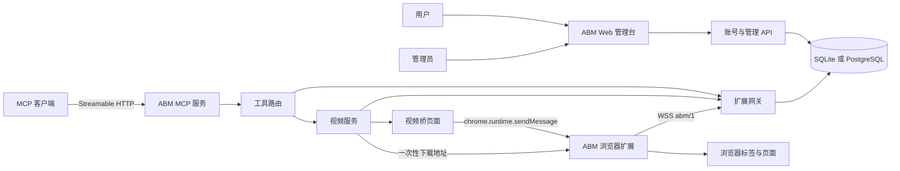
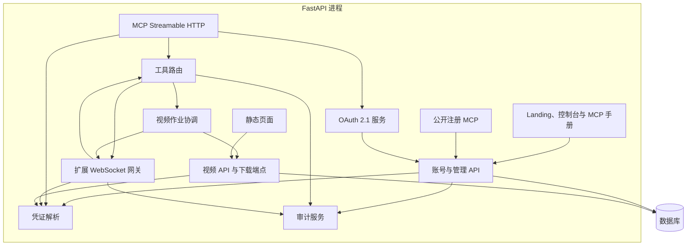
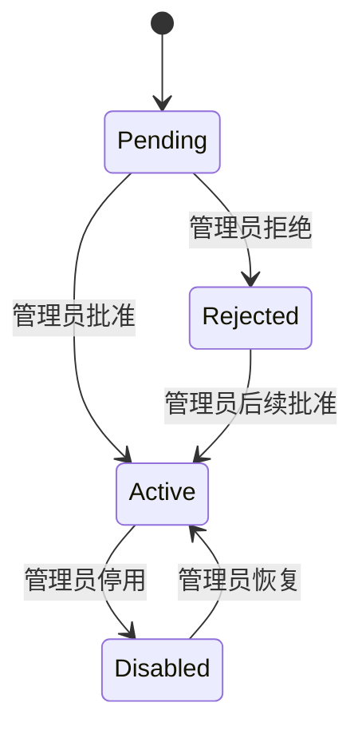
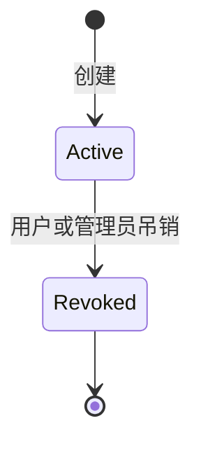
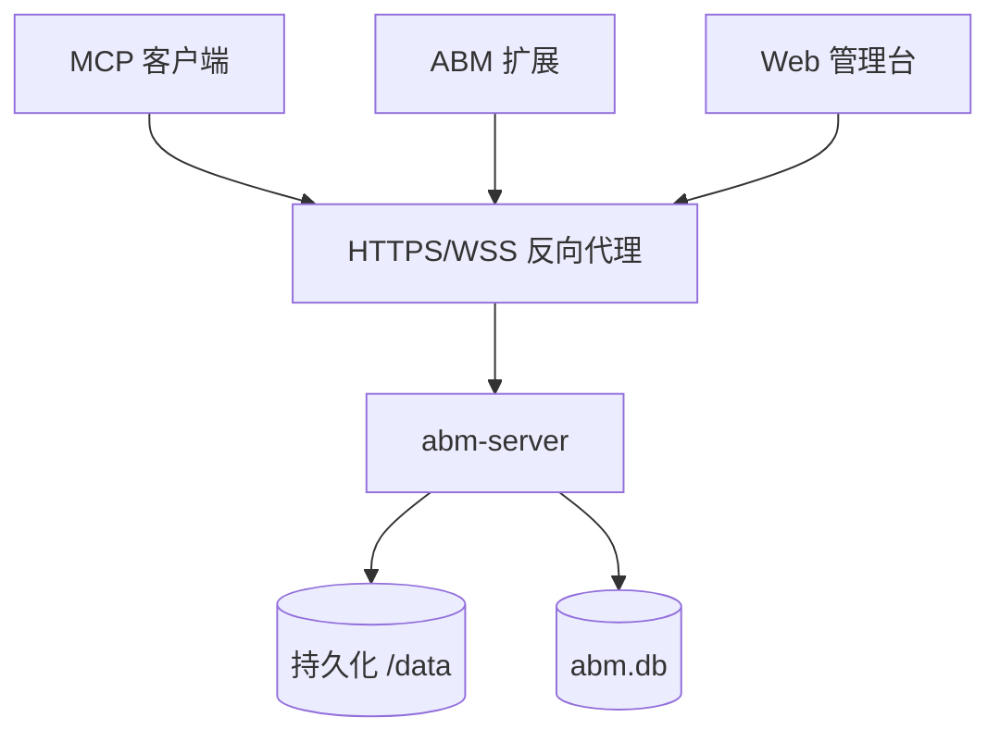

# ABM（a browser mcp） 架构设计

> 文档地图：[详细设计](detailed-design.md) · [数据流](data-flow.md) · [使用场景](scenarios.md) · [开发计划](development-plan.md) · [MCP 接入指南](mcp-agent-guide.md)
>
> 本文是系统契约层，定义目标架构、边界和公开协议；实现细节、时序图和操作示例分别在上述文档中展开。

## 1. 文档定位

ABM 是 **a browser mcp** 的简称。

本文定义 ABM（a browser mcp） 的完整目标架构，覆盖 Python 服务端、浏览器扩展、账号系统、API Key 生命周期、MCP 接口、浏览器网关协议、视频投递、安全边界、部署和测试策略。

项目统一使用以下命名空间：

- Python 包：`abm_server`
- 服务与镜像名称：`abm-server`
- CLI 入口：`abm-server`
- MCP 服务名：`abm-browser-mcp`
- 环境变量：`ABM_*`
- 业务错误码：`ABM_*`
- API Key 前缀：`abm_`
- 浏览器工具前缀：`browser_`
- 扩展存储命名空间：`abm.*`
- 扩展协议版本：`abm/1`

## 2. 产品目标

ABM（a browser mcp） 允许 AI 客户端通过标准 MCP 连接操作用户自己的浏览器。

首个生产版本必须提供：

- 用户自助提交注册申请，管理员审批。
- 密码登录和安全的账号会话。
- 单账号管理多把 API Key。
- 免费和付费套餐额度，不接入支付。
- 浏览器扩展通过已认证的 WebSocket 会话接入。
- 标准 MCP Streamable HTTP 接口。
- MCP OAuth 2.1 Authorization Code + PKCE + 动态客户端注册，支持固定连接和多连接授权。
- 通过 23 个 `browser_*` 工具提供完整浏览器能力。
- 通过 7 个账号/API Key 工具和 5 个管理员工具提供 MCP 内账号管理。
- 公开 `/mcp/public` 注册端点，仅暴露 `account_register`。
- 按 OAuth 授权范围和 API Key 连接严格隔离的多用户工具路由。
- 向扩展下发通知。
- bridge、url、auto 三种视频投递模式。
- 基于 SQLite 的可部署服务，并保持 PostgreSQL 可切换能力。

## 3. 非目标

首期不包含：

- 邮箱验证和找回密码。
- 支付、账单或订阅回调。
- API Key 的工具级权限细分。
- API Key 到期时间。
- 多实例共享实时 WebSocket 和视频状态。
- 原生前端构建系统。
- 跨账号的浏览器路由。

## 4. 系统上下文



系统有两个独立信任边界：

1. **账号边界**：密码与会话用于识别人类用户。
2. **运行边界**：OAuth 用于授权 MCP 客户端；API Key 用于浏览器扩展 WebSocket，并由扩展换取短期视频桥令牌。

账号会话与运行 API Key 使用不同的凭证、存储、有效期和吊销规则。

## 5. 仓库边界

### 5.1 `abm-cloud`

负责：

- 权威架构与协议契约。
- 账号、管理员、会话、套餐和 API Key API。
- 数据库模型与结构变更。
- 扩展 WebSocket 网关。
- MCP 服务与工具注册表。
- 视频作业协调和下载端点。
- 服务端网页与静态资源。
- 部署配置和服务端测试。

### 5.2 `abm-extension`

负责：

- 浏览器扩展 manifest 与 service worker。
- WebSocket 协议客户端和连接状态机。
- 浏览器工具实现。
- Chrome 权限、标签分组、通知和本地存储。
- popup 与账号管理入口。
- 视频接收器和桥页面外部消息。
- 扩展自动化测试和浏览器验证。

### 5.3 依赖规则

- 两个仓库仅通过文档化的 HTTP、WebSocket 和扩展外部消息契约通信。
- 任一仓库不得导入另一仓库的源码。
- 协议常量分别维护，通过契约测试保证一致。
- 公共协议变化必须同步更新架构文档、服务端测试、扩展测试和协议版本说明。

## 6. 服务端组件



推荐 Python 目录：

```text
abm_server/
  main.py
  config.py
  database.py
  models/
  accounts/
  api_keys/
  admin/
  auth/
  extension_gateway/
  mcp/
  social/
  tools/
  video/
  audit/
  web/
```

每个子包自行管理公开服务函数，不直接跨包访问其他模块的持久化实现。

关键模块职责：

| 模块 | 职责 |
|---|---|
| `accounts/service.py` | 注册、登录、会话、密码、账号资料和身份初始化 |
| `api_keys/service.py` | API Key 创建、列出、吊销、解析和套餐限额 |
| `admin/service.py` | 管理员账号筛选、状态/套餐修改、系统设置和审计查询 |
| `auth/security.py` | Argon2id、令牌摘要、API Key 生成和密码校验 |
| `auth/dependencies.py` | HTTP 会话、CSRF 和 API Key 认证依赖 |
| `auth/scopes.py` | OAuth scope 常量与默认值 |
| `extension_gateway/` | 扩展 WebSocket 网关、`abm/1` 信封和会话状态 |
| `mcp/service.py` | MCP OAuth 认证、公共端点、工具分发、scope/角色校验和 OAuth 用户路由 |
| `mcp/oauth.py` | OAuth provider、DCR、元数据、授权、令牌和吊销 |
| `social/` | 社交登录 provider 适配、state/PKCE、账号自动注册和身份绑定 |
| `mcp/tools.py` | 组合 browser、account 和 admin 工具定义 |
| `tools/browser.py` | 23 个 `browser_*` 工具 Schema |
| `video/service.py` | 视频作业、分片、下载令牌和桥接状态 |
| `web/routes.py` | Landing、登录/控制台、MCP 手册和 OAuth 同意页 |
| `models/` | 账号、API Key、审计、视频和 OAuth 表模型 |

旧顶层模块 `gateway.py`、`protocol.py`、`security.py`、`dependencies.py`、`mcp_service.py`、`mcp_tools.py` 仅作为兼容 re-export，不再承载业务实现。

## 7. 扩展组件

```text
src/
  core/
    protocol.js
    connection.js
    storage.js
    lifecycle.js
  tools/
    registry.js
    browser/
  video/
    receiver.js
    bridge-messages.js
  permissions/
  notices/
popup/
inject-scripts/
test/
```

职责：

- `core/protocol.js`：`abm/1` 信封校验、消息构造和错误常量。
- `core/connection.js`：WebSocket 生命周期、鉴权、心跳、重试和连接替换。
- `core/storage.js`：统一访问 `abm.*` 存储项。
- `tools/registry.js`：注册和分发全部 `browser_*` 工具。
- `tools/browser/`：浏览器、DOM、上传、CDP 和页面数据操作。
- `video/`：视频暂存状态与桥页面消息处理。
- `popup/`：连接设置、状态、通知、权限、账号入口和诊断。

service worker 被回收并重新启动后，只能依赖已持久化的配置、通知和视频作业元数据恢复状态。

## 8. 账号生命周期



注册策略由数据库设置控制：

- `ABM_REGISTRATION_REQUIRE_APPROVAL=true`：新账号进入 `pending`。
- `ABM_REGISTRATION_REQUIRE_APPROVAL=false`：新账号直接进入 `active`。

只有 `active` 账号可以登录。

数据库没有管理员时，如果同时提供以下两个变量，系统创建首个管理员：

- `ABM_BOOTSTRAP_ADMIN_EMAIL`
- `ABM_BOOTSTRAP_ADMIN_PASSWORD`

管理员存在后，启动引导变量不再生效。

## 9. 认证与会话

密码使用 Argon2id 哈希。

账号会话使用不透明明文令牌：

- Cookie 名：`abm_session`。
- Cookie 属性：`HttpOnly`、`SameSite=Lax`、可配置 `Secure`、路径 `/`。
- 绝对有效期：7 天。
- 数据库只保存会话令牌哈希。
- 修改密码后吊销其他所有会话。
- 退出登录时吊销当前会话。

写操作必须满足：

- 存在有效账号会话。
- 请求头携带 `X-CSRF-Token`。
- 浏览器请求的 `Origin` 与服务同源。

### 9.1 社交登录

社交登录用于 Web 账号注册和登录，不替代 MCP 的 OAuth 2.1 provider。用户在 `/login` 或 `/register` 选择微信、QQ、Google、GitHub、Microsoft 后，服务端完成 OAuth/OIDC 授权，并把外部身份绑定到 ABM 账号。

支持范围：

| Provider | 协议 | 邮箱验证来源 |
|---|---|---|
| WeChat | OAuth 2.0 | 不返回邮箱，首次注册需补充邮箱 |
| QQ | OAuth 2.0 | 不返回邮箱，首次注册需补充邮箱 |
| Google | OIDC | `email_verified` |
| GitHub | OAuth 2.0 | `/user/emails` 中的 verified 邮箱 |
| Microsoft | OIDC | Microsoft 账号的 `email` claim |

配置方式：

- `ABM_SOCIAL_WECHAT_CLIENT_ID` / `ABM_SOCIAL_WECHAT_CLIENT_SECRET`（微信开放平台网站应用 AppID / AppSecret）
- `ABM_SOCIAL_QQ_CLIENT_ID` / `ABM_SOCIAL_QQ_CLIENT_SECRET`（QQ 互联 APP ID / APP Key）
- `ABM_SOCIAL_GOOGLE_CLIENT_ID` / `ABM_SOCIAL_GOOGLE_CLIENT_SECRET`
- `ABM_SOCIAL_GITHUB_CLIENT_ID` / `ABM_SOCIAL_GITHUB_CLIENT_SECRET`
- `ABM_SOCIAL_MICROSOFT_CLIENT_ID` / `ABM_SOCIAL_MICROSOFT_CLIENT_SECRET`
- `ABM_SOCIAL_MICROSOFT_TENANT`，默认 `common`

回调地址固定为：

```text
{ABM_PUBLIC_BASE_URL}/api/v1/auth/social/{provider}/callback
```

未配置 client ID/secret 的 provider 不会出现在页面和 `/api/v1/auth/social/providers` 中。

安全规则：

- 每次授权生成一次性 `state` 和 PKCE S256；`state` 只保存 SHA-256 摘要，并通过短期 `abm_social_state_<provider>` HttpOnly Cookie 绑定当前浏览器，默认 600 秒过期。
- 只有 provider 明确返回已验证邮箱时，才允许自动注册或自动绑定。
- 微信和 QQ 不返回邮箱：首次登录进入 `/social/complete` 补充邮箱；不会按用户输入的邮箱自动绑定已有账号。已有账号必须先密码登录，再在控制台绑定。
- 补充邮箱注册的账号 `email_verified_at` 为空，并发送验证邮件；用户可以先使用社交身份登录。
- 新账号遵循 `registration_require_approval`：开启审批时进入 `pending`，不创建登录会话。
- 已有账号只有在 `email_verified_at` 非空时才允许按同邮箱自动绑定；未验证账号必须先密码登录后在控制台绑定。
- 邮箱型 provider 绑定要求 provider 邮箱与当前账号邮箱一致；微信/QQ 可以直接绑定到当前已登录账号。
- 自动注册的账号使用随机密码哈希，邮箱标记为已验证；用户可通过“忘记密码”设置密码。
- 已绑定身份按 `(provider, subject)` 唯一；解绑需要账号会话和 CSRF。
- `next` 只接受站内绝对路径，拒绝 `//`、反斜杠和外部地址。

社交登录成功后会创建与密码登录相同的账号会话 Cookie，因此随后打开 MCP OAuth 同意页时可以直接复用该会话；`/mcp` 的 OAuth token 生命周期和 scope 校验保持不变。

## 10. API Key 模型

API Key 是以下运行组件的凭证：

- 浏览器扩展 WebSocket 会话。
- 视频桥请求。

格式：

```text
abm_<public-prefix>_<secret>
```

规则：

- `public-prefix` 是 12 位 URL 安全随机标识。
- `secret` 至少包含 32 字节随机数据，并使用 base64url 编码。
- 完整明文只在创建接口返回一次。
- 数据库只保存公开前缀和完整 Key 的 SHA-256 摘要。
- 日志、审计、API 响应和 WebSocket 消息不得包含 Key 明文。
- 完整 Key 只能解析到一个 `api_key_id`。

生命周期：



已吊销 Key 不能恢复。账号可以在套餐额度内创建新 Key。

吊销必须：

1. 标记 Key 为已吊销。
2. 拒绝后续 HTTP 鉴权。
3. 关闭对应的扩展连接。
4. 拒绝该 Key 的 pending 工具调用。
5. 禁止访问该 Key 的视频作业和桥资源。

## 11. 套餐与额度

| 套餐 | 默认有效 Key 上限 | 计费 |
|---|---:|---|
| `free` | 2 | 暂不实现 |
| `pro` | 10 | 管理员手动管理 |

每个用户包含：

- `plan_code`
- `plan_expires_at`

过期的 `pro` 套餐按 `free` 计算。已有 Key 继续有效；当有效 Key 数量达到当前额度时，不能继续创建。

套餐变更写入账号审计事件。

## 12. 数据模型

所有 ID 使用 UUID 字符串，所有时间使用带时区的 UTC 时间。

### 12.1 `users`

| 字段 | 类型 | 约束 |
|---|---|---|
| `id` | UUID string | 主键 |
| `email` | string | 小写规范化，唯一，必填 |
| `password_hash` | string | Argon2id |
| `display_name` | string | 必填，去除首尾空白 |
| `application_note` | text | 可选 |
| `role` | enum string | `admin` 或 `user` |
| `status` | enum string | `pending`、`active`、`rejected`、`disabled` |
| `status_reason` | text | 可选管理员备注 |
| `plan_code` | enum string | `free` 或 `pro` |
| `plan_expires_at` | timestamp | 可空 |
| `email_verified_at` | timestamp | 可空；验证邮箱后写入 |
| `created_at` | timestamp | 必填 |
| `updated_at` | timestamp | 必填 |
| `approved_at` | timestamp | 可空 |
| `approved_by` | UUID string | 可空，关联 `users.id` |

索引：

- `email` 唯一索引。
- `(status, created_at)` 普通索引。

### 12.2 `account_sessions`

| 字段 | 类型 | 约束 |
|---|---|---|
| `id` | UUID string | 主键 |
| `user_id` | UUID string | 关联 `users.id` |
| `token_hash` | string | 唯一 SHA-256 摘要 |
| `csrf_hash` | string | SHA-256 摘要 |
| `created_at` | timestamp | 必填 |
| `expires_at` | timestamp | 必填 |
| `last_seen_at` | timestamp | 必填 |
| `revoked_at` | timestamp | 可空 |
| `user_agent` | string | 可选 |
| `ip_address` | string | 可选 |

索引：

- `token_hash` 唯一索引。
- `(user_id, revoked_at)` 普通索引。
- `expires_at` 普通索引。

### 12.3 `account_tokens`

| 字段 | 类型 | 约束 |
|---|---|---|
| `id` | UUID string | 主键 |
| `user_id` | UUID string | 关联 `users.id` |
| `purpose` | string | `email_verify` 或 `password_reset` |
| `token_hash` | string | 唯一 SHA-256 摘要 |
| `expires_at` | timestamp | 必填 |
| `used_at` | timestamp | 可空，一次性使用 |
| `created_at` | timestamp | 必填 |

邮箱验证和密码重置只保存 token 摘要；token 过期或使用后不能再次使用。

### 12.4 `api_keys`

| 字段 | 类型 | 约束 |
|---|---|---|
| `id` | UUID string | 主键 |
| `user_id` | UUID string | 关联 `users.id` |
| `name` | string | 必填 |
| `public_prefix` | string | 唯一查询值 |
| `key_hash` | string | 唯一 SHA-256 摘要 |
| `created_at` | timestamp | 必填 |
| `last_used_at` | timestamp | 可空 |
| `revoked_at` | timestamp | 可空 |
| `revoked_by` | UUID string | 可空，关联 `users.id` |

索引：

- `public_prefix` 唯一索引。
- `key_hash` 唯一索引。
- `(user_id, revoked_at)` 普通索引。

单把 Key 的 `last_used_at` 最多每 60 秒更新一次。

### 12.5 `settings`

| 字段 | 类型 | 约束 |
|---|---|---|
| `key` | string | 主键 |
| `value` | JSON string | 必填 |
| `updated_at` | timestamp | 必填 |
| `updated_by` | UUID string | 可空，关联 `users.id` |

初始设置：

```json
{"registration_require_approval": true}
```

### 12.6 `account_audit_events`

| 字段 | 类型 | 约束 |
|---|---|---|
| `id` | UUID string | 主键 |
| `actor_user_id` | UUID string | 可空 |
| `subject_user_id` | UUID string | 可空 |
| `api_key_id` | UUID string | 可空 |
| `event_type` | string | `ABM_*` 事件名 |
| `metadata` | JSON string | 已脱敏结构化数据 |
| `created_at` | timestamp | 必填 |

索引：

- `(subject_user_id, created_at)`。
- `(api_key_id, created_at)`。
- `event_type`。

## 13. HTTP API

应用 API 统一使用 `/api/v1` 前缀。

### 13.1 错误结构

```json
{
  "error": {
    "code": "ABM_KEY_LIMIT_REACHED",
    "message": "Current plan allows at most 5 active API keys.",
    "requestId": "req_...",
    "retryable": false,
    "action": "none"
  }
}
```

`code` 是稳定契约，客户端据此本地化；`message`、MCP 工具描述和 OAuth `error_description` 统一使用英文规范文案。

HTTP 状态码使用标准语义：

| HTTP 状态 | 用途 |
|---|---|
| 400 | 输入无效或请求格式错误 |
| 401 | 凭证缺失、无效、已吊销或已过期 |
| 403 | 账号状态、CSRF 或权限拒绝 |
| 404 | 资源不存在 |
| 409 | 邮箱重复、Key 数量上限或状态冲突 |
| 413 | 视频超过限制 |
| 429 | 请求频率过高 |
| 500 | 内部故障 |

### 13.2 公共认证

| 方法 | 路径 | 用途 |
|---|---|---|
| `POST` | `/api/v1/auth/register` | 提交注册申请 |
| `POST` | `/api/v1/auth/login` | 创建账号会话 |
| `GET` | `/api/v1/auth/social/providers` | 返回已配置的社交登录 provider |
| `GET` | `/api/v1/auth/social/{provider}/start` | 创建 state/PKCE 并跳转 provider |
| `GET` | `/api/v1/auth/social/{provider}/callback` | 处理 provider 回调、自动注册或登录 |
| `GET` | `/api/v1/auth/social/pending/{token}` | 读取微信/QQ 首次注册的待补充信息 |
| `POST` | `/api/v1/auth/social/complete` | 补充邮箱并完成微信/QQ 注册 |
| `POST` | `/api/v1/auth/password-reset/request` | 请求密码重置邮件，不暴露邮箱是否存在 |
| `POST` | `/api/v1/auth/password-reset/confirm` | 使用一次性 token 设置新密码 |
| `POST` | `/api/v1/auth/email-verification/confirm` | 使用一次性 token 验证邮箱 |

注册请求：

```json
{
  "email": "user@example.com",
  "password": "至少十个字符",
  "display_name": "Ada",
  "application_note": "使用场景说明"
}
```

注册响应使用通用接受结果，不暴露邮箱是否已经存在。

### 13.3 账号会话

| 方法 | 路径 | 用途 |
|---|---|---|
| `GET` | `/api/v1/auth/me` | 返回当前账号和 CSRF 元数据 |
| `POST` | `/api/v1/auth/logout` | 吊销当前会话 |
| `PATCH` | `/api/v1/auth/password` | 修改密码并吊销其他会话 |
| `POST` | `/api/v1/auth/email-verification/request` | 发送邮箱验证邮件 |
| `GET` | `/api/v1/auth/sessions` | 列出当前账号的活跃会话 |
| `DELETE` | `/api/v1/auth/sessions/{id}` | 撤销指定会话 |
| `POST` | `/api/v1/auth/sessions/revoke-others` | 撤销除当前会话外的全部会话 |
| `GET` | `/api/v1/auth/account/export` | 导出账号、Key 元数据、会话、用量和审计摘要 |
| `DELETE` | `/api/v1/auth/account` | 密码确认后删除账号 |
| `GET` | `/api/v1/auth/identities` | 列出已绑定的社交身份和可用 provider |
| `DELETE` | `/api/v1/auth/identities/{id}` | 解绑社交身份 |
| `GET` | `/api/v1/notices` | 当前账号的通知列表和未读数 |
| `POST` | `/api/v1/notices/{id}/read` | 标记单条通知已读 |
| `POST` | `/api/v1/notices/read-all` | 全部标记已读 |

### 13.4 API Key

| 方法 | 路径 | 用途 |
|---|---|---|
| `GET` | `/api/v1/api-keys` | 返回不含秘密的 Key 元数据 |
| `POST` | `/api/v1/api-keys` | 创建 Key，并一次性返回明文 |
| `DELETE` | `/api/v1/api-keys/{id}` | 吊销 Key |

创建请求：

```json
{"name": "办公浏览器"}
```

创建响应：

```json
{
  "id": "uuid",
  "name": "办公浏览器",
  "prefix": "abm_a1b2c3d4e5f6",
  "plaintext": "abm_a1b2c3d4e5f6_<secret>",
  "createdAt": "2026-10-19T00:00:00Z"
}
```

### 13.5 管理员 API

| 方法 | 路径 | 用途 |
|---|---|---|
| `GET` | `/api/v1/admin/users` | 筛选并列出用户；支持 `status`、`plan`、`q`、`limit`、`offset`，返回 `total` |
| `PATCH` | `/api/v1/admin/users/{id}` | 修改状态、套餐、到期时间或备注 |
| `GET` | `/api/v1/admin/settings` | 读取系统设置 |
| `PATCH` | `/api/v1/admin/settings` | 修改注册审批策略 |
| `GET` | `/api/v1/admin/audit` | 读取账号审计事件；支持 `event_type`、`actor`、`subject`、`from`、`to`、`limit`、`offset`，返回 `total` 与 actor / subject 名称 |
| `GET` / `PUT` | `/api/v1/admin/plans`、`/api/v1/admin/plans/{plan}` | 读取 / 更新 free、pro 的创作额度和模型绑定 |
| `GET` / `POST` | `/api/v1/admin/creation/providers` | 列出 / 新增 OpenAI 兼容模型连接；Key 加密存储，只返回末 4 位 |
| `PATCH` / `DELETE` | `/api/v1/admin/creation/providers/{id}` | 编辑 / 删除连接；仍被套餐绑定时拒绝删除 |
| `POST` | `/api/v1/admin/creation/providers/{id}/test` | 测试连接并更新状态 |
| `GET` / `PATCH` | `/api/v1/admin/system` | 读取 / 更新注册审批、创作台开关、BYOK 和保留策略 |
| `GET` / `PATCH` | `/api/v1/admin/system/config` | 按分组读取 / 更新运行参数（数据库覆盖） |
| `GET` | `/api/v1/admin/system/config/export` | 导出数据库覆盖参数 JSON |
| `POST` | `/api/v1/admin/system/config/import` | 导入参数 JSON，支持 merge / replace |

模型连接 Key 使用 `ABM_CREATION_SECRET_KEY` 派生的 AES-GCM 加密，API 和审计只暴露末 4 位。

运行参数覆盖保存在 `system_configs`（key / group / value / updated_by）。服务启动时加载并合并到 `Settings`，保存后立即写回当前进程的 `Settings`，无需重启；标记 `restartRequired` 的参数在下次启动生效。数据库 URL、加密密钥、OAuth / 社交 / SMTP 密码、bootstrap 账号等仍只允许环境变量，不通过导入或管理 API 暴露。

用户修改和系统设置变更会在审计元数据中写入 `changes: {field: {before, after}}`；审计列表与详情不保存密码、Key、令牌或正文。

用户修改请求：

```json
{
  "status": "active",
  "plan_code": "pro",
  "plan_expires_at": "2026-12-31T23:59:59Z",
  "reason": "批准生产环境使用"
}
```

### 13.6 创作 API

| 方法 | 路径 | 用途 |
|---|---|---|
| `GET` | `/api/v1/creation/platforms` | 平台约束（主稿 / 小红书 / 公众号 / 视频号 / 知乎） |
| `GET` / `POST` | `/api/v1/creation/projects` | 列出 / 新建项目 |
| `PATCH` / `DELETE` | `/api/v1/creation/projects/{id}` | 更新 / 归档项目 |
| `GET` / `POST` | `/api/v1/creation/assets` | 列出 / 新建资产（新建即写入版本 1） |
| `GET` / `PATCH` / `DELETE` | `/api/v1/creation/assets/{id}` | 读取 / 更新 / 移入回收站 |
| `POST` | `/api/v1/creation/assets/{id}/restore` | 从回收站恢复资产 |
| `DELETE` | `/api/v1/creation/assets/{id}/purge` | 彻底删除资产及其版本 |
| `GET` / `POST` | `/api/v1/creation/assets/{id}/versions` | 版本列表 / 新建版本 |
| `GET` | `/api/v1/creation/templates` | 静态工作流模板 |
| `GET` | `/api/v1/creation/publish/targets` | 可发布平台与编辑器地址 |
| `GET` / `POST` | `/api/v1/creation/publish/tasks` | 发布任务列表 / 新建任务（保存资产快照） |
| `GET` | `/api/v1/creation/publish/tasks/{id}` | 任务详情（含标题与正文快照） |
| `POST` | `/api/v1/creation/publish/tasks/{id}/open` | 以高优先级打开前台编辑器标签组 |
| `POST` | `/api/v1/creation/publish/tasks/{id}/close` | 关闭标签组并释放会话 |
| `POST` | `/api/v1/creation/publish/tasks/{id}/published` | 记录发布链接并标记已发布 |
| `POST` | `/api/v1/creation/research/diagnostics` | 检查扩展连接与一次最小工具调用，返回失败阶段和错误码 |
| `GET` / `POST` | `/api/v1/creation/research/jobs` | 检索任务列表 / 新建任务（返回查询计划） |
| `GET` | `/api/v1/creation/research/jobs/{id}` | 任务详情与已采集来源 |
| `POST` | `/api/v1/creation/research/jobs/{id}/pause\|resume\|cancel` | 暂停 / 继续 / 取消 |
| `GET` | `/api/v1/creation/research/jobs/{id}/events` | SSE 事件流，支持 `Last-Event-ID` 续传 |
| `GET` | `/api/v1/creation/sources` | 来源列表；支持 `q`、`domain`、`job_id` 与分页 |
| `GET` / `DELETE` | `/api/v1/creation/sources/{id}` | 来源详情（含正文）/ 移入回收站 |
| `POST` | `/api/v1/creation/sources/{id}/restore` | 恢复来源并重置 30 天保留期 |
| `DELETE` | `/api/v1/creation/sources/{id}/purge` | 彻底删除来源正文 |
| `GET` | `/api/v1/creation/trash` | 回收站（资产与来源合并） |
| `POST` | `/api/v1/creation/trash/empty` | 清空回收站 |

创作数据全部按 `user_id` 归属，跨用户访问返回 404。来源正文保留 30 天（`creation_config.retentionDays`），到期进入回收站保留 10 天（`trashDays`），之后由维护任务硬删除。检索作业每个用户同时最多 1 个（free）/ 2 个（pro），月度页数额度来自套餐 `pagesPerMonth`。业务错误使用 `ABM_CREATION_*` 前缀，例如 `ABM_CREATION_JOB_LIMIT`、`ABM_CREATION_QUOTA_EXCEEDED`。项目列表额外返回 `assetCount`；归档项目会把其资产的 `project_id` 置空而不是删除资产。

### 13.7 运行状态

| 方法 | 路径 | 凭证 | 用途 |
|---|---|---|---|
| `GET` | `/api/v1/session/status` | API Key | 当前扩展连接和视频作业 |
| `GET` | `/api/v1/audit` | API Key | 当前 Key 的近期运行事件 |

### 13.8 OAuth 2.1

| 方法 | 路径 | 认证 | 用途 |
|---|---|---|---|
| `GET` | `/.well-known/oauth-protected-resource/mcp` | 无 | MCP 资源元数据 |
| `GET` | `/.well-known/oauth-authorization-server` | 无 | 授权服务器元数据 |
| `POST` | `/register` | 无 | 动态客户端注册（DCR） |
| `GET` | `/authorize` | 无 | OAuth 授权请求入口 |
| `GET` | `/oauth/authorize` | 账号 Cookie | 登录检查和授权同意页 |
| `POST` | `/oauth/authorize` | 账号 Cookie + CSRF | 批准或拒绝授权 |
| `POST` | `/token` | public client + PKCE | 授权码或 refresh token 换令牌 |
| `POST` | `/revoke` | public client | 吊销 access/refresh token |

OAuth 采用 Authorization Code + PKCE（S256）。动态注册客户端固定为 public client，不签发 client secret。授权码一次性使用；access token 和 refresh token 只保存 SHA-256 摘要；refresh token 使用后轮换。

支持的 scopes：

| Scope | 用途 |
|---|---|
| `browser` | 调用 `browser_*` 工具 |
| `account:read` | 读取账号、套餐、API Key 元数据和审计 |
| `account:write` | 修改账号资料/密码、创建/吊销 API Key、管理员操作 |

OAuth access token 通过 `subject` 映射到用户，并携带授权时选择的连接策略：`pinned` 固定一个连接，`pool` 允许一组连接，`auto` 允许该用户所有在线连接。浏览器任务通过 `browser_open_session` 获取服务端生成的 `browserSessionId`，该句柄独占一个连接；其他任务不能同时占用同一连接，返回 `ABM_CONNECTION_BUSY`。连接断开或租约过期后释放。没有在线连接时返回 `ABM_EXTENSION_OFFLINE`。管理员工具仍按用户角色二次校验。

## 14. Web 管理台

服务端页面使用原生 JavaScript 做中英文切换，语言选择保存在 `abm.lang`。`/`、`/docs/mcp`、`/register`、`/login`、`/console`、`/admin`、`/video-bridge` 和 `/oauth/authorize` 均支持中英文。未保存语言时按客户端语言（zh 或 en，其他回退 en）；手动选择后覆盖默认。

首屏由 `base.html` 的内联脚本在绘制前解析 `abm.lang` 和 `navigator.languages`。英文客户端先隐藏中文模板并在 2 秒后兜底解除，`i18n.js` 应用翻译后立即显示；这样避免中文内容闪现。首次访问不会把自动检测结果写成手动选择，只有点击语言按钮才持久化。

| 路径 | 页面 |
|---|---|
| `/` | Chrome 扩展 landing page、下载入口、MCP 接入说明 |
| `/register` | 注册申请，支持社交账号自动注册 |
| `/login` | 登录，支持安全 `next` 回跳和社交一键登录 |
| `/social/complete` | 微信/QQ 首次登录补充邮箱并完成注册 |
| `/console` | 账号、Key 管理、套餐、用量和登录方式（旧版，保持可用） |
| `/console/{section}` | 新版工作区壳：`overview`、`connections`、`usage`、`account`、`help` |
| `/admin` | 用户审批、套餐管理、系统设置和审计（旧版，保持可用） |
| `/admin/{section}` | 新版管理后台壳：`overview`、`users`、`approvals`、`plans`、`audit`、`system` |
| `/docs/mcp` | Agent MCP 安装使用手册 |
| `/video-bridge` | 视频分片桥页面 |
| `/oauth/authorize` | OAuth 授权同意页 |

页面使用 FastAPI 模板和少量原生 JavaScript，不依赖 Node 构建。

控制台支持“一键连接扩展”：通过受信外部消息把服务器地址和 API Key 写入扩展，扩展校验 `sender.origin` 与目标服务器同源后保存并连接。控制台按概览、连接、用量、账号四个标签组织，提供 Claude Code、Codex CLI、Cursor/Windsurf 和通用 HTTP MCP 的配置生成、扩展状态、工作流模板、账号数据导出和通知中心。账号页可以绑定或解绑微信、QQ、Google、GitHub、Microsoft 登录方式。

API Key 明文只在创建后的一次性确认面板中展示，并提供明确的复制操作。

## 15. 扩展 WebSocket 协议

端点：

```text
GET /api/v1/extension/ws
Sec-WebSocket-Protocol: abm.v1
```

所有 JSON 消息使用：

```json
{
  "v": "abm/1",
  "id": "message-or-request-id",
  "type": "message.type",
  "payload": {}
}
```

规则：

- `v` 必须等于 `abm/1`。
- 请求和响应必须包含 `id`。
- 通知可以使用 `null` 作为 `id`。
- 未知消息类型返回 `ABM_PROTOCOL_ERROR`。
- 为支持后续增量字段，接收方忽略未知字段。

### 15.1 消息类型

| 方向 | 类型 | 用途 |
|---|---|---|
| 扩展 -> 服务端 | `session.hello` | 鉴权并注册扩展 |
| 服务端 -> 扩展 | `session.ready` | 确认会话并返回账号信息 |
| 扩展 -> 服务端 | `session.identify` | 更新扩展身份元数据 |
| 服务端 -> 扩展 | `session.ping` | 心跳 |
| 扩展 -> 服务端 | `session.pong` | 心跳响应 |
| 服务端 -> 扩展 | `tool.invoke` | 调用浏览器工具 |
| 扩展 -> 服务端 | `tool.result` | 返回工具结果 |
| 服务端 -> 扩展 | `notice.push` | 下发通知 |
| 服务端 -> 扩展 | `error` | 返回协议或业务错误 |

### 15.2 会话初始化

```json
{
  "v": "abm/1",
  "id": "msg-1",
  "type": "session.hello",
  "payload": {
    "apiKey": "abm_a1b2c3d4e5f6_<secret>",
    "extensionId": "chrome-extension-id",
    "extensionVersion": "1.0.0",
    "browserId": "browser_<stable-uuid>",
    "capabilities": {
      "tabGroups": true,
      "sharedSessions": true
    }
  }
}
```

服务端必须在连接建立后 10 秒内收到 `session.hello`。

### 15.3 会话就绪

```json
{
  "v": "abm/1",
  "id": "msg-1",
  "type": "session.ready",
  "payload": {
    "protocolVersion": "abm/1",
    "extensionId": "chrome-extension-id",
    "account": {
      "id": "uuid",
      "displayName": "Ada",
      "planCode": "free"
    },
    "apiKeyId": "uuid",
    "connectionId": "conn_<stable-id>",
    "browserId": "browser_<stable-uuid>",
    "capabilities": {"tabGroups": true, "sharedSessions": true},
    "serverTime": "2026-10-19T00:00:00Z"
  }
}
```

### 15.4 工具调用

```json
{
  "v": "abm/1",
  "id": "tool-request-uuid",
  "type": "tool.invoke",
  "payload": {
    "name": "browser_click",
    "arguments": {"selector": "#submit"}
  }
}
```

成功结果：

```json
{
  "v": "abm/1",
  "id": "tool-request-uuid",
  "type": "tool.result",
  "payload": {
    "status": "ok",
    "content": [{"type": "text", "text": "{\"clicked\":true}"}]
  }
}
```

失败结果：

```json
{
  "v": "abm/1",
  "id": "tool-request-uuid",
  "type": "tool.result",
  "payload": {
    "status": "error",
    "error": {
      "code": "ABM_TOOL_EXECUTION_FAILED",
      "message": "元素当前不可见"
    }
  }
}
```

### 15.5 连接归属

- API Key 是凭证与归属边界；一个 Key 可绑定多个浏览器实例。
- 每个浏览器实例由 `connectionId` 标识，来自 Key + 稳定的 `browserId`。
- 支持 `browserId` 的扩展可多实例并存；未上报的旧扩展仍按“同 Key 替换”处理。
- 每个连接按能力共享任务会话：`sharedSessions: true` 时最多 3 个，默认预留 1 个高优先级位给发布。
- 连接断开只释放该连接的租约和 pending 调用，不影响同 Key 的其他连接。
- 每 Key 连接数受 `ABM_EXTENSION_MAX_CONNECTIONS_PER_KEY` 限制。
- 不同 API Key 不共享工具路由、通知、pending 调用或视频作业。

### 15.6 多浏览器与任务组

- `browser_open_session` 可按 `connectionId` 固定目标浏览器，否则选择负载最低的在线连接。
- 返回的 `connectionId` 是任务粘性标识；工具调用携带 `context: {taskId, groupTitle, collapsed}`。
- 扩展按 `taskId` 创建标签组并校验标签归属；不同任务组可以并行。
- 研究任务使用后台、折叠组；发布任务使用前台、展开组，并以 `priority=100` 使用预留位。
- 关闭任务会调用 `browser_control close_group` 关闭标签组并释放租约。
- `/api/v1/session/status` 与 `/api/v1/extension/status` 返回 `connections` 列表和 `connectionCount`。

### 15.7 心跳

- 服务端每 30 秒发送 `session.ping`。
- 任意有效消息都会刷新 `last_seen`。
- 90 秒无活动的连接会被关闭。
- 扩展对可重试错误使用带抖动的指数退避。

## 16. 错误码与关闭语义

WebSocket 错误消息：

```json
{
  "v": "abm/1",
  "id": null,
  "type": "error",
  "payload": {
    "code": "ABM_INVALID_API_KEY",
    "message": "API Key 无效。",
    "retryable": false,
    "action": "open_account_portal",
    "retryAfterMs": null
  }
}
```

允许的 `action`：

- `open_account_portal`
- `reauthenticate`
- `wait`
- `upgrade_extension`
- `none`

### 16.1 会话错误映射

| 业务错误码 | WebSocket 关闭码 | 可重试 | 动作 |
|---|---|---:|---|
| `ABM_PROTOCOL_ERROR` | 1008 | 否 | `upgrade_extension` |
| `ABM_HELLO_TIMEOUT` | 1013 | 是 | `wait` |
| `ABM_DUPLICATE_HELLO` | 1008 | 否 | `none` |
| `ABM_INVALID_API_KEY` | 1008 | 否 | `open_account_portal` |
| `ABM_API_KEY_REVOKED` | 1008 | 否 | `open_account_portal` |
| `ABM_ACCOUNT_DISABLED` | 1008 | 否 | `reauthenticate` |
| `ABM_CONNECTION_REPLACED` | 1000 | 否 | `none` |
| `ABM_HEARTBEAT_TIMEOUT` | 1001 | 是 | `wait` |
| `ABM_SERVER_SHUTTING_DOWN` | 1001 | 是 | `wait` |
| `ABM_CONNECTION_LIMIT` | 1013 | 是 | `wait` |
| `ABM_RATE_LIMITED` | 1013 | 是 | `wait` |
| `ABM_INTERNAL_ERROR` | 1011 | 是 | `wait` |

只使用标准 WebSocket 关闭码。

### 16.2 账号与 Key 错误

| 错误码 | HTTP 状态 |
|---|---:|
| `ABM_VALIDATION_ERROR` | 400 |
| `ABM_INVALID_CREDENTIALS` | 401 |
| `ABM_SESSION_EXPIRED` | 401 |
| `ABM_ACCOUNT_PENDING` | 403 |
| `ABM_ACCOUNT_REJECTED` | 403 |
| `ABM_ACCOUNT_DISABLED` | 403 |
| `ABM_CSRF_INVALID` | 403 |
| `ABM_FORBIDDEN` | 403 |
| `ABM_EMAIL_EXISTS` | 409 |
| `ABM_KEY_LIMIT_REACHED` | 409 |
| `ABM_KEY_NOT_FOUND` | 404 |
| `ABM_KEY_ALREADY_REVOKED` | 409 |
| `ABM_RATE_LIMITED` | 429 |

### 16.3 工具与视频错误

| 错误码 | 含义 |
|---|---|
| `ABM_EXTENSION_OFFLINE` | 当前 Key 没有在线扩展 |
| `ABM_CONNECTION_BUSY` | 目标连接已被其他浏览器任务占用 |
| `ABM_BROWSER_SESSION_REQUIRED` | 多连接授权需要先创建 browserSessionId |
| `ABM_BROWSER_SESSION_INVALID` | browserSessionId 不存在、过期或连接离线 |
| `ABM_CONNECTION_FORBIDDEN` | 目标连接不在 OAuth 授权范围内 |
| `ABM_TOOL_NOT_FOUND` | 工具未注册 |
| `ABM_TOOL_TIMEOUT` | 工具调用超时 |
| `ABM_TOOL_EXECUTION_FAILED` | 浏览器工具执行失败 |
| `ABM_TOOL_RESULT_INVALID` | 扩展结果校验失败 |
| `ABM_QUOTA_EXCEEDED` | 当前套餐月度配额已用尽 |
| `ABM_VIDEO_EMPTY` | 视频内容为空 |
| `ABM_VIDEO_TOO_LARGE` | 视频超过限制 |
| `ABM_VIDEO_BUSY` | 当前 Key 或服务端的活跃视频作业已达上限 |
| `ABM_VIDEO_SOURCE_FETCH_FAILED` | 源地址下载失败 |
| `ABM_VIDEO_DELIVERY_FAILED` | 视频投递失败 |
| `ABM_VIDEO_JOB_NOT_FOUND` | 当前 Key 找不到视频作业 |
| `ABM_VIDEO_TOKEN_INVALID` | 下载令牌错误 |
| `ABM_VIDEO_EXPIRED` | 视频作业或下载地址已过期 |
| `ABM_VIDEO_PERMISSION_REQUIRED` | 扩展缺少目标域名权限 |

## 17. MCP 接口

服务端通过以下方式提供 MCP：

- `/mcp` 的 Streamable HTTP，需要 OAuth 2.1 access token。
- `/mcp/public` 的 Streamable HTTP，无需认证，仅暴露 `account_register`。

OAuth 客户端使用：

```http
Authorization: Bearer <oauth_access_token>
```

未认证的 `/mcp` 请求返回 `401` 和 `WWW-Authenticate`，其中包含受保护资源元数据地址。

工具可见性按 scope 和角色动态计算：

- OAuth：23 个 browser + 7 个 account/API Key 工具；管理员账号额外看到 5 个管理员工具。
- `/mcp/public`：只返回 `account_register`。

MCP SDK v2 负责 JSON-RPC、协议版本协商、`server/discover` 和传输错误，并同时服务 2026-07-28 与更早的握手式客户端。工具业务失败使用标准 MCP 工具错误结果，并在结构化错误数据中携带 `ABM_*` 错误码。

### 17.1 MCP 浏览器任务句柄

- 2026-07-28 协议没有 `Mcp-Session-Id`；跨调用状态使用服务端生成的显式句柄。
- `browser_open_session` 生成 `browserSessionId`，绑定用户、连接、OAuth 允许范围和 TTL。
- 后续浏览器工具携带 `browserSessionId`，服务器校验归属和授权范围后路由到对应连接。
- `browser_close_session` 释放句柄；连接断开或 TTL 到期也会释放。
- `pinned` OAuth 可以直接使用固定连接，不必显式创建句柄；`pool` 和 `auto` 在无法确定唯一连接时要求先创建句柄。
- 租约和扩展连接一样保存在进程内；多副本部署需要共享状态或按连接路由。

## 18. MCP 工具

### 18.1 浏览器工具

全部 23 个浏览器工具使用 `browser_` 命名空间，需要 `browser` scope，并要求用户有在线扩展连接。浏览器任务通过 `browserSessionId` 独占连接，其他任务不能同时占用同一连接。

| 工具 | 能力 |
|---|---|
| `browser_inject_script` | 在页面主环境执行 JavaScript；页面 CSP 禁止 eval 时通过 CDP 兜底 |
| `browser_read_page_data` | 读取 window 点分路径数据 |
| `browser_navigate` | 导航标签并等待加载状态 |
| `browser_control` | 查询、更新、激活或关闭标签 |
| `browser_extract_data` | 提取元素、window 或 document 数据 |
| `browser_click` | 按选择器或文本点击元素 |
| `browser_fill` | 填充输入框和可编辑元素 |
| `browser_keyboard` | 发送键盘输入 |
| `browser_upload_file` | 注入单个 base64 文件 |
| `browser_set_files` | 注入多个 base64 文件 |
| `browser_set_files_from_urls` | 下载并注入多个文件 |
| `browser_wait_elements` | 等待选择器达到指定数量 |
| `browser_set_video_to_page` | 将暂存视频注入文件输入框 |
| `browser_download_video_from_url` | 下载视频到扩展暂存区 |
| `browser_network_intercept` | 抓取并检查网络请求 |
| `browser_mouse_click` | 执行 CDP 鼠标点击 |
| `browser_mouse_scroll` | 执行 CDP 滚轮滚动 |
| `browser_input_sequence` | 回放 CDP 输入事件序列 |
| `browser_set_files_native` | 通过 CDP 注入本地文件路径 |
| `browser_stage_video` | 通过服务端暂存并投递视频 |
| `browser_send_notice` | 向扩展推送通知 |
| `browser_open_session` | 创建浏览器任务句柄并独占连接 |
| `browser_close_session` | 释放浏览器任务句柄 |

### 18.2 账号与 API Key 工具

| 工具 | Scope | 能力 |
|---|---|---|
| `account_register` | 公共 | 提交注册申请；结果不暴露邮箱是否存在 |
| `account_me` | `account:read` | 读取当前账号、套餐、Key 数量、扩展连接状态和认证方式 |
| `account_update_profile` | `account:write` | 修改显示名称 |
| `account_change_password` | `account:write` | 修改密码，并吊销其他账号会话和 OAuth 凭证 |
| `api_key_list` | `account:read` | 列出 API Key 元数据，不返回明文 |
| `api_key_create` | `account:write` | 创建 API Key，并一次性返回明文 |
| `api_key_revoke` | `account:write` | 吊销 API Key，并关闭使用该 Key 的扩展连接 |

`account_register` 同时存在于 `/mcp` 和 `/mcp/public`。公共端点按 IP 限流。

### 18.3 管理员工具

| 工具 | Scope | 能力 |
|---|---|---|
| `admin_list_users` | `account:read` | 按状态和关键词筛选账号 |
| `admin_update_user` | `account:write` | 修改状态、套餐、到期时间或备注 |
| `admin_get_settings` | `account:read` | 读取系统设置 |
| `admin_update_settings` | `account:write` | 修改注册审批策略 |
| `admin_list_audit` | `account:read` | 读取账号审计事件 |

管理员工具只在 `tools/list` 中对管理员账号可见，调用时仍会校验 `admin` 角色。普通用户调用返回 `ABM_ADMIN_REQUIRED`。

工具 Schema 变化必须同步更新两个仓库，并针对公开的 `abm/1` 契约运行兼容测试。

### 18.4 `browser_navigate` 标签复用

复用范围一律由目标 URL 推导，不枚举站点。参数如下：

| 参数 | 类型 | 说明 |
|---|---|---|
| `reuse` | `boolean \| "site" \| "origin"` | `true` 或 `"site"`（默认）复用同主机标签，忽略 `www.`、`m.`、`mobile.` 前缀，不跨子域；`"origin"` 要求协议、主机、端口完全一致；`false` 总是新建标签 |
| `reuseKey` | `string` | 显式工作标签名，同一 key 始终落到同一标签；标签被关闭后按站点规则兜底重建 |

成功结果的 `reuseMode` 取值为 `"site"`、`"origin"`、`"key"` 或 `null`，用于说明本次采用的复用方式。扩展不再返回 `cleanedTabIds`，服务端也不解析 `warnings` 或 `cleanedTabIds`。

## 19. 视频投递

### 19.1 模式

| 模式 | 流程 |
|---|---|
| `bridge` | 源数据流式写入临时文件（内存只保留分片），桥页面读取分片并发送给扩展；交付、失败或 TTL 到期后删除 |
| `url` | URL 源由扩展直接下载原始地址，服务端不接触视频字节；base64 源写入临时文件并由一次性地址提供给扩展 |
| `auto` | URL 源优先直连；base64 源扩展在线时走 url，否则 bridge；权限不足不会静默回退到服务器中转 |

临时文件只用于在途投递，不是持久化存储。单 Key 活跃作业和全局活跃作业都有上限，超限返回 `ABM_VIDEO_BUSY`。本机大文件应优先使用 `browser_set_files_native`，让字节留在用户机器上。

### 19.2 视频 API

| 方法 | 路径 | 凭证 |
|---|---|---|
| `GET` | `/api/v1/video/extension` | 公开，仅返回配置的目标扩展 ID |
| `POST` | `/api/v1/video/bridge-token` | API Key，签发短期视频桥令牌 |
| `GET` | `/api/v1/video/config` | API Key 或 bridge token |
| `GET` | `/api/v1/video/jobs?pending=1` | API Key 或 bridge token |
| `GET` | `/api/v1/video/jobs/{id}/chunks/{index}` | API Key 或 bridge token |
| `POST` | `/api/v1/video/jobs/{id}/result` | API Key 或 bridge token |
| `GET` | `/api/v1/downloads/{id}/{fileName}?token=...` | 一次性令牌 |

视频桥页面路径为 `/video-bridge`。

### 19.3 桥页面消息

| 类型 | 用途 |
|---|---|
| `abm.bridge.check` | 检查扩展可用性和目标扩展 ID |
| `abm.bridge.config` | 受信桥页面获取扩展 ID、服务地址和短期 bridge token（不返回 API Key） |
| `abm.video.begin` | 开始视频暂存 |
| `abm.video.chunk` | 传输一个 base64 分片 |
| `abm.video.finish` | 完成视频暂存 |
| `abm.video.cancel` | 取消视频暂存 |
| `abm.video.info` | 读取暂存视频元数据 |

桥页面只接受扩展 manifest 的 `externally_connectable.matches` 中声明的来源。

扩展 ID 使用 `ABM_EXTENSION_ID` 固定配置，不根据最近在线连接推断。桥页面从
扩展取得 API Key 和目标 ID 后，再调用 `/api/v1/video/config` 校验该 Key 当前
绑定的扩展 ID；两者不一致时拒绝桥接，避免多用户或扩展换代时投递到错误实例。

### 19.4 下载令牌

- 每个 URL 模式作业拥有独立随机令牌。
- 令牌使用常量时间比较。
- 令牌只在作业 pending 时有效。
- 成功交付后释放视频内容。
- 后续访问返回 `ABM_VIDEO_EXPIRED`。

## 20. 安全模型

| 领域 | 控制 |
|---|---|
| 密码 | Argon2id 哈希和最小长度校验 |
| 账号会话 | 不透明哈希令牌、HttpOnly Cookie、7 天有效期 |
| CSRF | 每会话 CSRF 哈希和必需请求头 |
| API Key | 高熵秘密、公开前缀、SHA-256 摘要 |
| OAuth 授权码 | 一次性使用、短有效期、只保存 SHA-256 摘要 |
| OAuth 令牌 | access/refresh token 只保存摘要；refresh 轮换；支持吊销 |
| OAuth 客户端 | dynamic registration 固定 public client + PKCE，不签发 client secret |
| OAuth redirect_uri | 非回环地址必须 HTTPS |
| 日志 | 只展示 Key 前缀或脱敏标识，不记录令牌和密码 |
| 多租户路由 | OAuth 授权范围 + `browserSessionId` 独占租约；API Key 精确 `api_key_id` 归属，无跨用户回退 |
| 吊销 | 立即拒绝 HTTP 请求并关闭 WebSocket；账号停用同时吊销 OAuth 令牌 |
| 管理员访问 | HTTP 和 MCP 管理员操作都校验 `admin` 角色 |
| 注册滥用 | 网页和公共 MCP 注册均按 IP 限流 |
| 浏览器桥 | 由 manifest 控制可信来源 |
| 视频桥令牌 | 短期、仅限视频路由；页面不接收 API Key |
| 视频下载 | 每作业独立一次性令牌 |
| 文件与数据库 | 非 root 运行，数据目录独立挂载 |

安全相关修改必须覆盖未授权、跨用户、已吊销、已停用和已过期状态测试。

## 21. 服务端配置

| 变量 | 默认值 | 用途 |
|---|---|---|
| `ABM_HOST` | `0.0.0.0` | HTTP 绑定地址 |
| `ABM_PORT` | `18050` | HTTP 与 WebSocket 端口 |
| `ABM_DATABASE_URL` | `sqlite+aiosqlite:///./data/abm.db` | 数据库连接 |
| `ABM_PUBLIC_BASE_URL` | 空 | 对外链接基础地址，同时作为 OAuth issuer 回退 |
| `ABM_OAUTH_ISSUER_URL` | 空 | 显式 OAuth issuer；为空时使用 `ABM_PUBLIC_BASE_URL` |
| `ABM_OAUTH_ACCESS_TOKEN_TTL_SECONDS` | `3600` | OAuth access token 有效期 |
| `ABM_OAUTH_REFRESH_TOKEN_TTL_SECONDS` | `2592000` | OAuth refresh token 有效期 |
| `ABM_OAUTH_AUTHORIZATION_CODE_TTL_SECONDS` | `300` | 授权码有效期 |
| `ABM_OAUTH_PENDING_TTL_SECONDS` | `600` | 待确认授权请求有效期 |
| `ABM_EXTENSION_GITHUB_URL` | GitHub 仓库 | Landing 页扩展源码入口 |
| `ABM_EXTENSION_RELEASE_URL` | GitHub Releases | Landing 页扩展下载入口 |
| `ABM_EXTENSION_STORE_URL` | 空 | 可选 Chrome Web Store 入口 |
| `ABM_FORWARDED_ALLOW_IPS` | `127.0.0.1` | 允许提供代理转发头的来源 |
| `ABM_SESSION_COOKIE_SECURE` | `true` | 安全账号 Cookie |
| `ABM_EMAIL_MODE` | `log` | `log` 本地打印邮件链接，`smtp` 发送邮件 |
| `ABM_SMTP_HOST` | 空 | SMTP 主机 |
| `ABM_SMTP_PORT` | `587` | SMTP 端口 |
| `ABM_SMTP_USERNAME` | 空 | SMTP 用户名 |
| `ABM_SMTP_PASSWORD` | 空 | SMTP 密码 |
| `ABM_SMTP_FROM` | `ABM <no-reply@localhost>` | 发件人 |
| `ABM_SMTP_STARTTLS` | `true` | SMTP STARTTLS |
| `ABM_EMAIL_VERIFICATION_TTL_SECONDS` | `86400` | 邮箱验证链接有效期 |
| `ABM_PASSWORD_RESET_TTL_SECONDS` | `3600` | 密码重置链接有效期 |
| `ABM_REGISTRATION_REQUIRE_APPROVAL` | `true` | 初始审批策略 |
| `ABM_SOCIAL_LOGIN_ENABLED` | `true` | 是否启用已配置的社交登录 |
| `ABM_SOCIAL_LOGIN_STATE_TTL_SECONDS` | `600` | state/PKCE 请求有效期 |
| `ABM_SOCIAL_WECHAT_CLIENT_ID` | 空 | 微信开放平台网站应用 AppID |
| `ABM_SOCIAL_WECHAT_CLIENT_SECRET` | 空 | 微信开放平台网站应用 AppSecret |
| `ABM_SOCIAL_QQ_CLIENT_ID` | 空 | QQ 互联 APP ID |
| `ABM_SOCIAL_QQ_CLIENT_SECRET` | 空 | QQ 互联 APP Key |
| `ABM_SOCIAL_GOOGLE_CLIENT_ID` | 空 | Google OAuth client ID |
| `ABM_SOCIAL_GOOGLE_CLIENT_SECRET` | 空 | Google OAuth client secret |
| `ABM_SOCIAL_GITHUB_CLIENT_ID` | 空 | GitHub OAuth App client ID |
| `ABM_SOCIAL_GITHUB_CLIENT_SECRET` | 空 | GitHub OAuth App client secret |
| `ABM_SOCIAL_MICROSOFT_CLIENT_ID` | 空 | Microsoft Entra application client ID |
| `ABM_SOCIAL_MICROSOFT_CLIENT_SECRET` | 空 | Microsoft Entra client secret |
| `ABM_SOCIAL_MICROSOFT_TENANT` | `common` | Microsoft tenant，`common` 支持个人和工作账号 |
| `ABM_BOOTSTRAP_ADMIN_EMAIL` | 空 | 首个管理员邮箱 |
| `ABM_BOOTSTRAP_ADMIN_PASSWORD` | 空 | 首个管理员密码 |
| `ABM_MAX_ACTIVE_KEYS_FREE` | `2` | 免费套餐 Key 上限 |
| `ABM_MAX_ACTIVE_KEYS_PRO` | `10` | 付费套餐 Key 上限 |
| `ABM_QUOTA_TOOL_CALLS_FREE` | `1000` | 免费套餐月工具调用软配额 |
| `ABM_QUOTA_TOOL_CALLS_PRO` | `20000` | 付费套餐月工具调用软配额 |
| `ABM_QUOTA_VIDEO_BYTES_FREE` | `524288000` | 免费套餐月视频中转字节软配额 |
| `ABM_QUOTA_VIDEO_BYTES_PRO` | `10737418240` | 付费套餐月视频中转字节软配额 |
| `ABM_QUOTA_VIDEO_JOBS_FREE` | `10` | 免费套餐月视频作业软配额 |
| `ABM_QUOTA_VIDEO_JOBS_PRO` | `200` | 付费套餐月视频作业软配额 |
| `ABM_QUOTA_ENFORCEMENT` | `hard` | `hard` 超限阻断浏览器工具，`soft` 只展示 |
| `ABM_ALERT_WEBHOOK_URL` | 空 | 用量阈值 Webhook 地址 |
| `ABM_TOOL_TIMEOUT_MS` | `300000` | 默认工具超时 |
| `ABM_MCP_SESSION_LEASE_TTL_SECONDS` | `1800` | 浏览器任务连接租约有效期 |
| `ABM_VIDEO_CHUNK_BYTES` | `20971520` | 视频分片大小 |
| `ABM_VIDEO_JOB_TTL_MS` | `1800000` | 视频作业有效期 |
| `ABM_VIDEO_MAX_JOBS_PER_KEY` | `2` | 单 API Key 活跃视频作业上限 |
| `ABM_VIDEO_MAX_JOBS_TOTAL` | `20` | 服务端活跃视频作业总上限 |
| `ABM_VIDEO_TEMP_DIR` | 空 | 视频临时目录；为空时使用系统临时目录下的 `abm-video` |
| `ABM_VIDEO_BRIDGE_TOKEN_TTL_SECONDS` | `3600` | 视频桥短期令牌有效期 |
| `ABM_MAX_VIDEO_BYTES` | `2147483648` | 单视频大小上限 |
| `ABM_VIDEO_DELIVERY` | `auto` | 默认视频模式 |
| `ABM_HEARTBEAT_MS` | `30000` | WebSocket 心跳间隔 |
| `ABM_STALE_TIMEOUT_MS` | `90000` | WebSocket 失活超时 |
| `ABM_LOG_LEVEL` | `info` | 日志级别 |

## 22. 部署



容器要求：

- Python 3.12 slim 基础镜像。
- 非 root 运行时用户。
- 应用文件尽量只读。
- `/data` 可写卷用于 SQLite 和运行数据。
- 健康检查访问 `/healthz`。
- 实时 WebSocket 路由不依赖独立 worker 进程。

使用 PostgreSQL 时，将 `ABM_DATABASE_URL` 设置为 `postgresql+asyncpg` 地址，并执行同一套 Alembic 变更。

## 23. 测试策略

### 23.1 服务端

- 输入校验、密码哈希、Key 生成和错误映射单元测试。
- 使用隔离 SQLite 数据库的异步集成测试。
- 注册、审批、登录、CSRF、Key 上限、吊销和管理员授权的 API 测试。
- OAuth discovery、DCR、PKCE 授权、同意/拒绝、token、refresh、revoke 和未认证 401 测试。
- `/mcp/public` 注册限流和“仅 account_register”工具可见性测试。
- MCP 双协议协商、工具列表、browser/account/admin 工具和 scope/角色拒绝测试。
- 覆盖全部会话状态和错误路径的 WebSocket 测试。
- 三种视频模式与下载令牌校验测试。

### 23.2 扩展

- 协议信封和错误映射测试。
- 连接状态、重试和替换测试。
- 工具注册与能力测试。
- 视频接收器和桥消息测试。
- popup 渲染与账号入口测试。
- Chrome 中的权限、标签分组、上传、CDP 和视频注入手工验证。

### 23.3 契约测试

- 使用共享测试夹具验证消息类型、字段名、错误码和关闭码行为。
- 两个仓库分别针对同一组 `abm/1` 示例运行契约测试。
- 契约测试不得导入另一仓库源码。

## 24. 运行可观测性

结构化日志包括：

- 请求 ID。
- 已认证用户 ID。
- API Key 前缀和 Key ID。
- 扩展 ID。
- 工具名称和耗时。
- 视频作业 ID 和投递模式。
- 错误码。

密码、会话令牌、CSRF 令牌、API Key 秘密和视频字节不得写入日志。

健康检查：

- `/healthz`：进程存活。
- `/readyz`：数据库连接与结构就绪。

## 25. 架构决策汇总

| 决策 | 选择 |
|---|---|
| 服务端语言 | Python 3.12 |
| Web 框架 | FastAPI |
| 持久化 | SQLAlchemy Async 与 Alembic |
| 初始数据库 | SQLite |
| PostgreSQL 目标 | 可切换异步连接 |
| 账号凭证 | Argon2id 密码 |
| 浏览器会话 | 数据库不透明会话 |
| 运行凭证 | 哈希存储的 `abm_` API Key |
| 扩展传输 | `abm/1` WebSocket |
| MCP 传输 | Streamable HTTP |
| 工具命名 | `browser_*` |
| 业务错误 | `ABM_*` |
| WebSocket 关闭 | 仅标准关闭码 |
| UI 技术 | Jinja 模板与原生 JavaScript |
| 套餐 | 只预留字段与额度 |


## 26. 用量计量

`usage_daily` 按 `(api_key_id, day)` 聚合，用于看板和后续配额/计费：

| 字段 | 说明 |
|---|---|
| `tool_calls` | 浏览器工具调用次数 |
| `video_jobs` | 视频作业数 |
| `video_bytes` | 服务端中转的视频字节 |
| `day` | UTC 日期 `YYYY-MM-DD` |

计数规则：

- 每次解析出 `api_key_id` 后记录一次浏览器工具调用；OAuth 调用按实际使用的连接 Key 归属。
- `browser_stage_video` 额外记录视频作业和 `relayedBytes`。
- URL 直连和本机路径不产生 `video_bytes`；base64 或 bridge 中转按实际字节计。
- 计量失败只记录日志，不影响工具调用本身。
- 控制台通过 `GET /api/v1/usage/summary?days=30` 展示总量和按 Key 明细。

套餐配额（可配置）：

| 套餐 | 工具调用/月 | 视频中转/月 | 视频作业/月 |
|---|---|---|---|
| Free | 1,000 | 500MB | 10 |
| Pro | 20,000 | 10GB | 200 |

`GET /api/v1/usage/summary` 同时返回 `plan` 和 `quotas`，控制台显示进度条和超出状态。`ABM_QUOTA_ENFORCEMENT=hard` 时超限阻断新的浏览器工具和视频作业；`soft` 只展示不阻断。支付仍在后续阶段接入。

用量达到 80% 或 100% 时，服务端只发送一次对应阈值通知：

- 扩展在线时推送 `notice.push`
- 发送邮件（`ABM_EMAIL_MODE`）
- 配置 `ABM_ALERT_WEBHOOK_URL` 时 POST JSON Webhook

阈值状态保存在 `usage_alerts`，按 `(api_key_id, month, threshold)` 去重。
