# ABM Server 数据流

> 本文用端到端时序说明数据如何流动、由谁拥有、在哪里失败。公开字段和错误码见 [architecture.md](architecture.md)，实现细节见 [detailed-design.md](detailed-design.md)。

## 0. 参与方与边界

| 参与方 | 说明 |
|---|---|
| Browser | 用户浏览器中的 ABM Web 页面 |
| Web/API | FastAPI Web 路由与 `/api/v1` |
| Accounts | 账号、会话、API Key、管理员服务 |
| DB | SQLite / PostgreSQL |
| Gateway | 扩展 WebSocket 网关 |
| Extension | Chrome 扩展 service worker |
| MCP Client | 支持 Streamable HTTP + OAuth 的 MCP 客户端 |
| MCP | `/mcp` / `/mcp/public` |
| OAuth | 授权服务器与同意页 |
| Video | 视频作业协调器 |
| Bridge | `/video-bridge` 桥页面 |

信任边界：

- **账号边界**：Cookie 会话 + CSRF。
- **MCP 边界**：OAuth access token + scope + 连接策略。
- **扩展边界**：API Key + 单一活动 WebSocket。
- **页面边界**：扩展注入脚本只能访问被授权的标签页。

## 1. 注册与审批

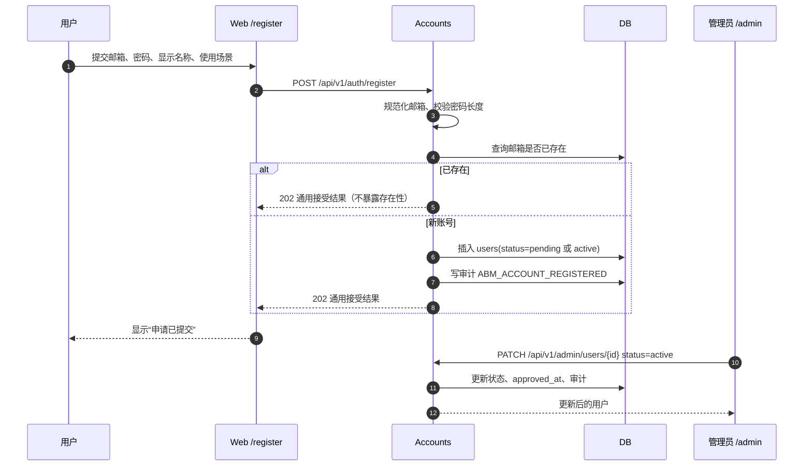

要点：

- 注册响应不泄露邮箱是否存在。
- 审批策略来自 `settings.registration_require_approval`。
- 待审批、拒绝、停用账号不能登录。
- 审批和套餐修改写入审计。

## 2. 登录与会话

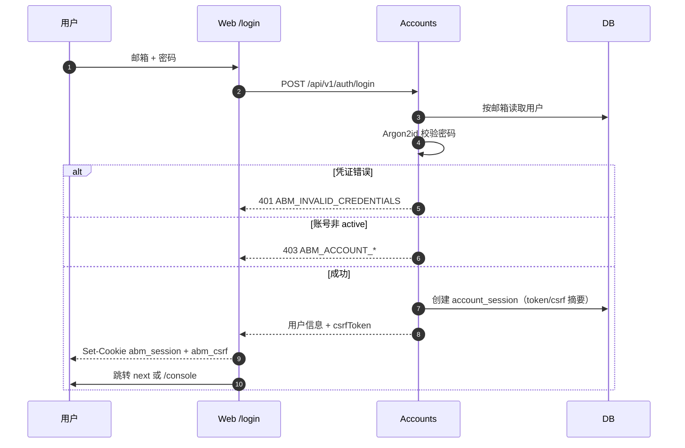

后续写请求：

```text
Cookie: abm_session=...
X-CSRF-Token: <abm_csrf 的值>
Origin: <同源>
```

服务端校验 CSRF 摘要和 Origin；失败返回 `ABM_CSRF_INVALID`。

### 2.1 社交登录与自动注册

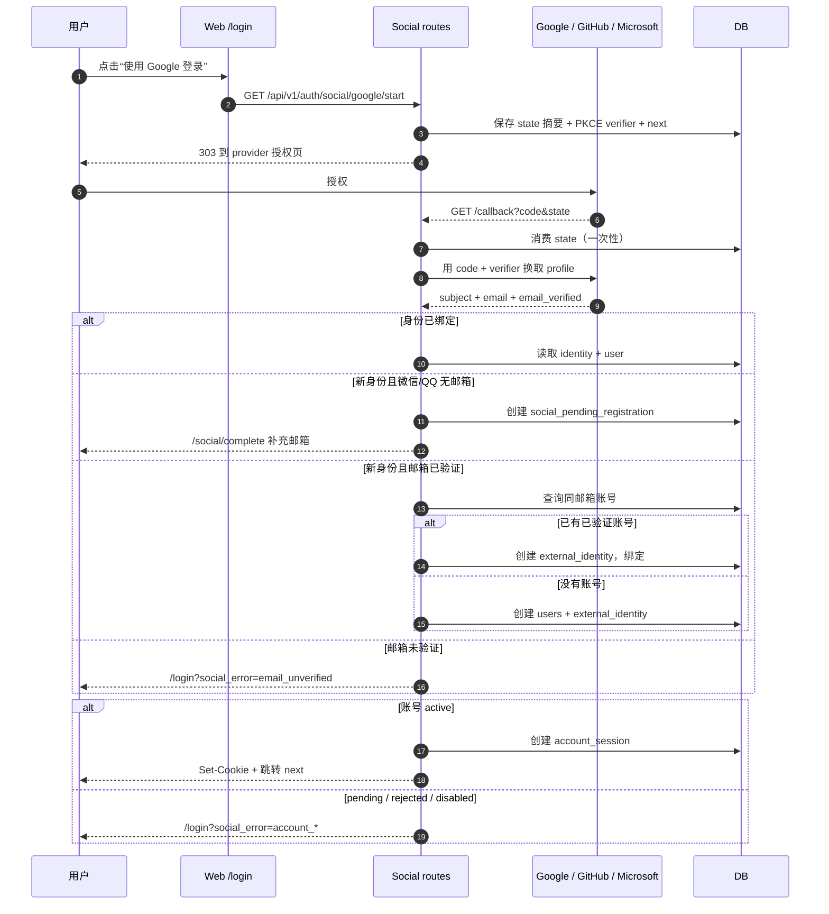

要点：

- 未验证邮箱不能自动注册或绑定。
- state 绑定 `abm_social_state_<provider>` HttpOnly Cookie，回调必须同时匹配 state 和 Cookie。
- 微信/QQ 不返回邮箱；首次注册跳转 `/social/complete`，补充邮箱后创建 `email_verified_at=null` 的账号并发送验证邮件。
- 补充邮箱若已属于现有账号，不自动绑定，要求密码登录后在控制台绑定。
- 同邮箱已有账号但邮箱未验证时返回 `email_conflict`，要求先密码登录再绑定。
- 审批开启时，社交自动注册只创建 `pending` 账号，不创建会话。
- 社交登录成功后的账号会话与密码登录一致；MCP OAuth 仍需单独授权。

## 3. 创建 API Key 与扩展连接

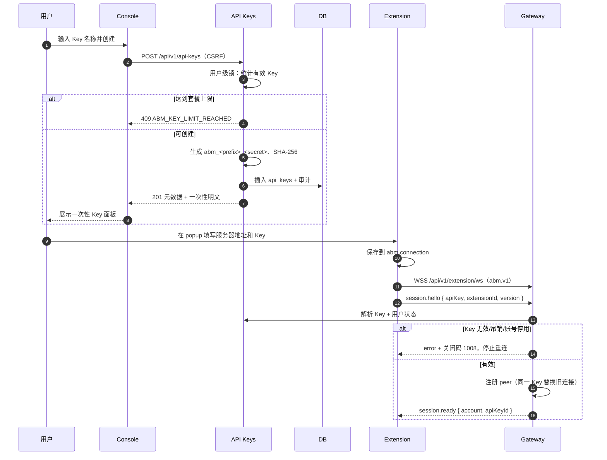

要点：

- 完整 Key 只出现一次；数据库只有摘要。
- 同一 API Key 最多一个活动扩展连接；新连接替换旧连接。
- Key 吊销会立即关闭对应连接；账号停用会关闭该用户全部连接。

## 4. 扩展 WebSocket 与工具调用

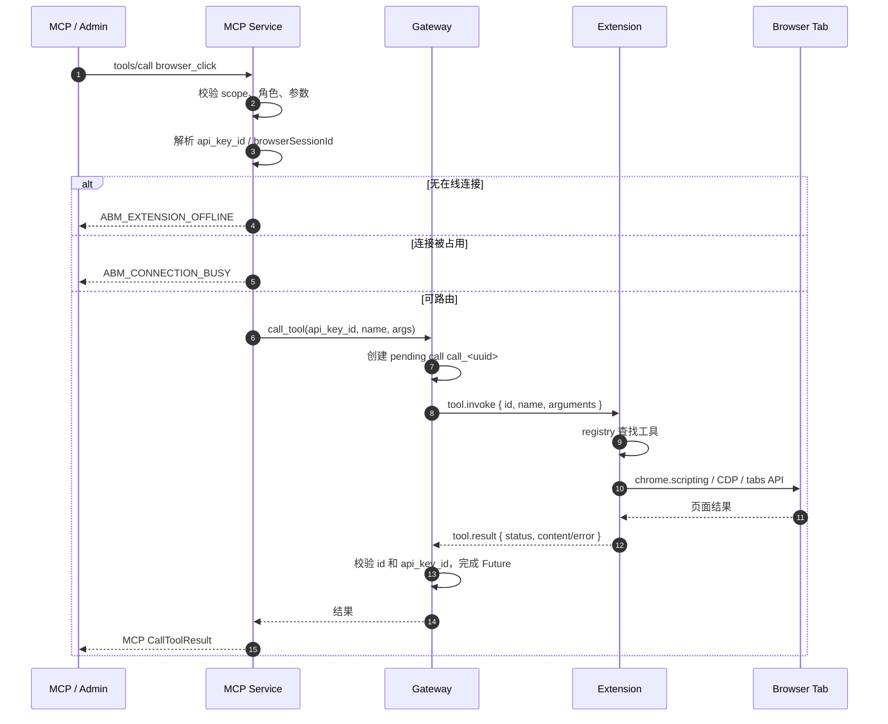

失败路径：

| 位置 | 错误 |
|---|---|
| 扩展离线 | `ABM_EXTENSION_OFFLINE` |
| 连接被其他会话占用 | `ABM_CONNECTION_BUSY` |
| 工具未注册 | `ABM_TOOL_NOT_FOUND` |
| 扩展执行异常 | `ABM_TOOL_EXECUTION_FAILED` |
| 超时 | `ABM_TOOL_TIMEOUT` |
| 结果结构不合法 | `ABM_TOOL_RESULT_INVALID` |

## 5. MCP OAuth 连接

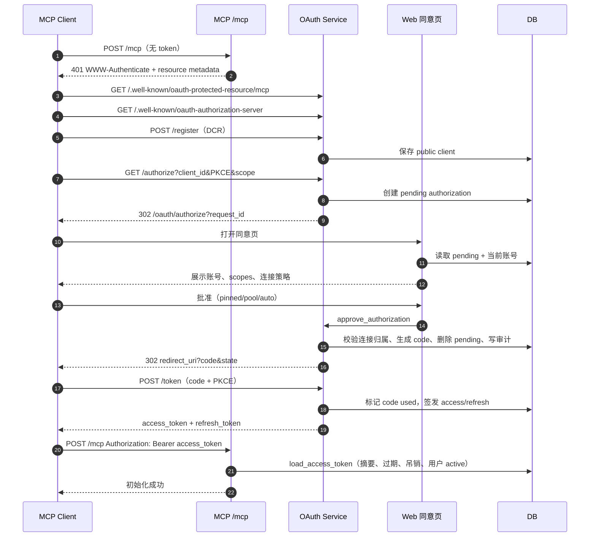

刷新与吊销：

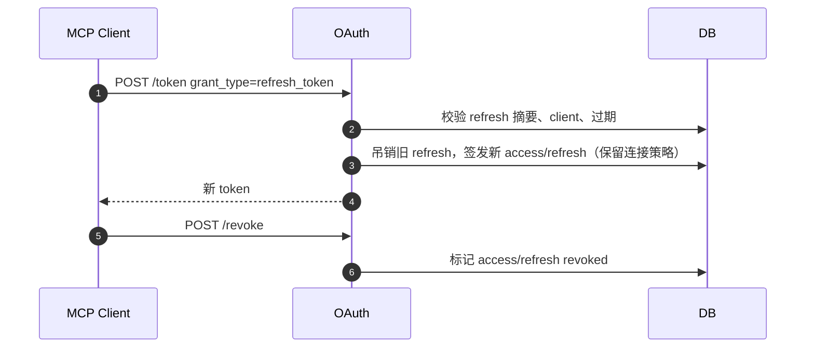

## 6. 浏览器工具与 browserSessionId

### 6.1 pinned

```mermaid
sequenceDiagram
    autonumber
    participant C as MCP Client
    participant M as MCP
    participant G as Gateway
    C->>M: browser_navigate（OAuth pinned，无 browserSessionId）
    M->>M: connection_mode=pinned → 固定 api_key_id
    M->>G: call_tool
    G-->>M: 结果
    M-->>C: 结果
```

### 6.2 pool / auto

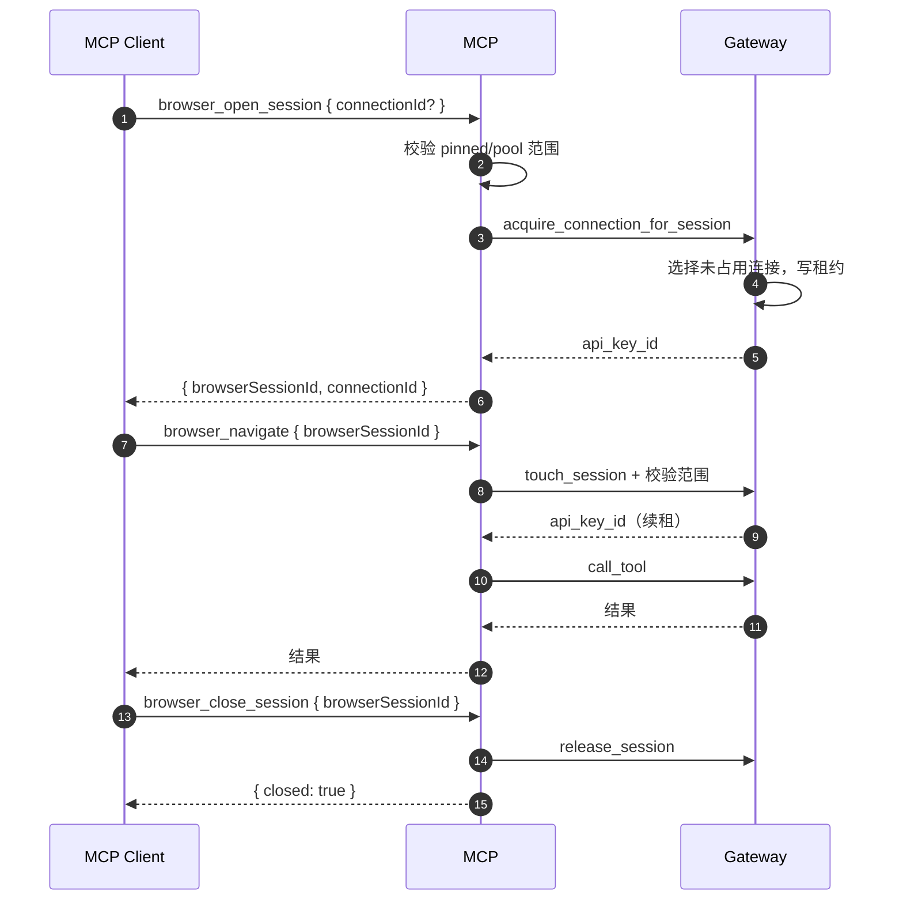

错误：

- `auto` / `pool` 没有 `browserSessionId` → `ABM_BROWSER_SESSION_REQUIRED`。
- `browserSessionId` 不存在、过期、连接离线 → `ABM_BROWSER_SESSION_INVALID`。
- 连接不在 OAuth 范围 → `ABM_CONNECTION_FORBIDDEN`。
- 所有连接被占用 → `ABM_CONNECTION_BUSY`。
- 无在线连接 → `ABM_EXTENSION_OFFLINE`。

## 7. 账号 / API Key / 管理员 MCP 工具

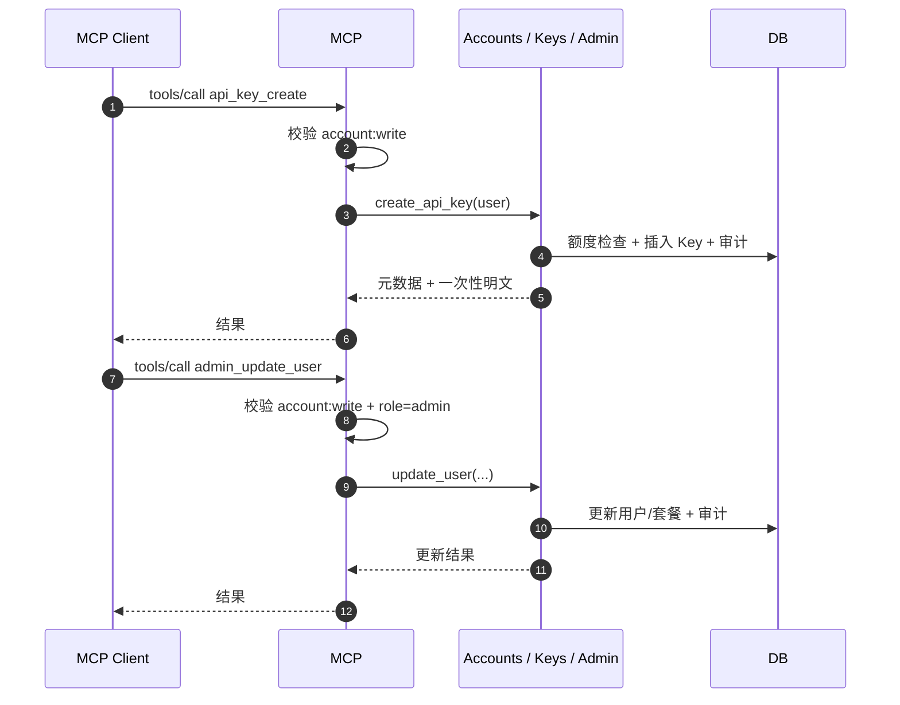

普通用户调用管理员工具 → `ABM_ADMIN_REQUIRED`；跨用户操作不会通过参数注入，工具始终使用当前 OAuth 用户。

## 8. 视频投递

### 8.1 bridge

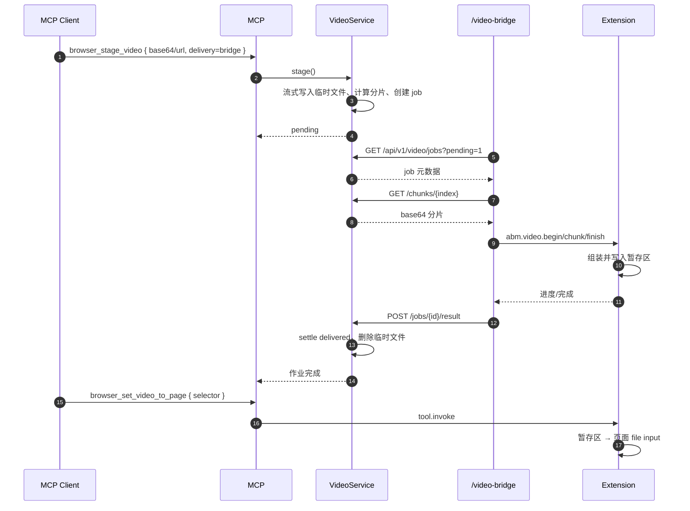

### 8.2 url

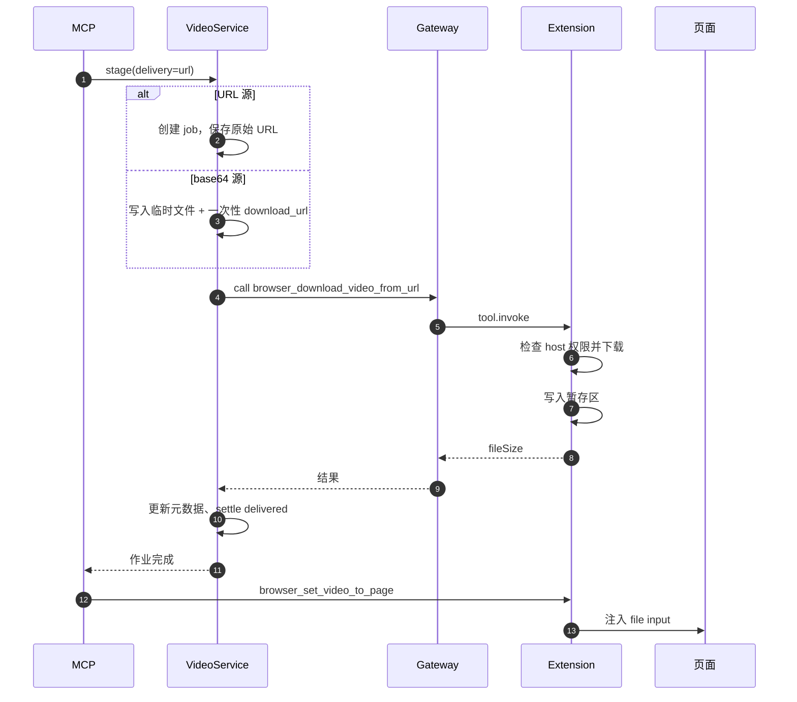

### 8.3 auto

- URL 源：扩展直接下载原始地址，服务端不接触视频字节。
- base64 源 + 扩展在线：`url`（服务端临时托管）。
- base64 源 + 扩展离线：`bridge`。
- 权限不足返回 `ABM_VIDEO_PERMISSION_REQUIRED`，不静默回退到服务器中转。
- 本机大文件优先 `browser_set_files_native`，字节不经过服务端。

## 9. 通知下发

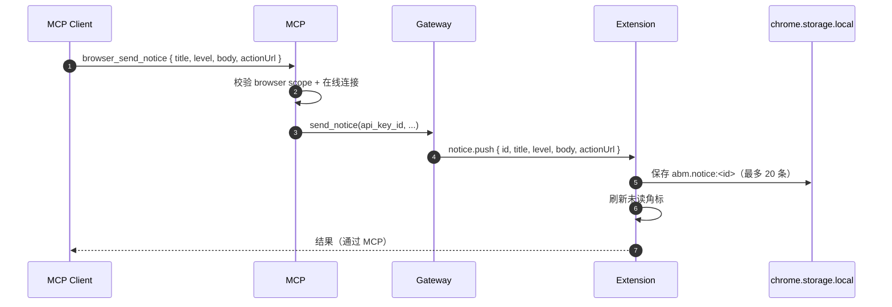

## 10. 吊销、停用与断开传播

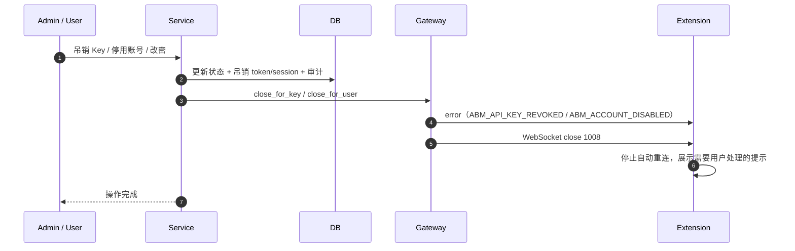

要点：

- 吊销/停用先落库，再关闭连接；关闭失败不回滚业务状态。
- 账号停用同时吊销 OAuth token，MCP 客户端下次请求得到 401。
- Web 修改密码只吊销其他账号会话；MCP `account_change_password` 还会吊销除当前 access token 外的其他 OAuth token。

## 11. 数据所有权速查

| 数据 | 所有者 | 生命周期 |
|---|---|---|
| 用户、会话、Key、OAuth、审计 | 数据库 | 持久 |
| 扩展连接、pending 调用 | Gateway 进程内存 | 连接/调用期间 |
| 浏览器任务租约 | Gateway 进程内存 | TTL 或 close |
| 视频作业与临时文件 | VideoService 临时目录 | TTL，交付/失败后删除 |
| 视频桥分片 | 服务端临时文件 → 扩展暂存区 | 桥接期间 / 30 分钟 |
| 扩展通知 | `chrome.storage.local` | 最近 20 条 |
| 扩展配置 | `chrome.storage.local` | 持久 |
