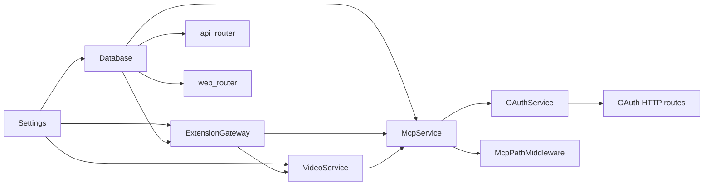
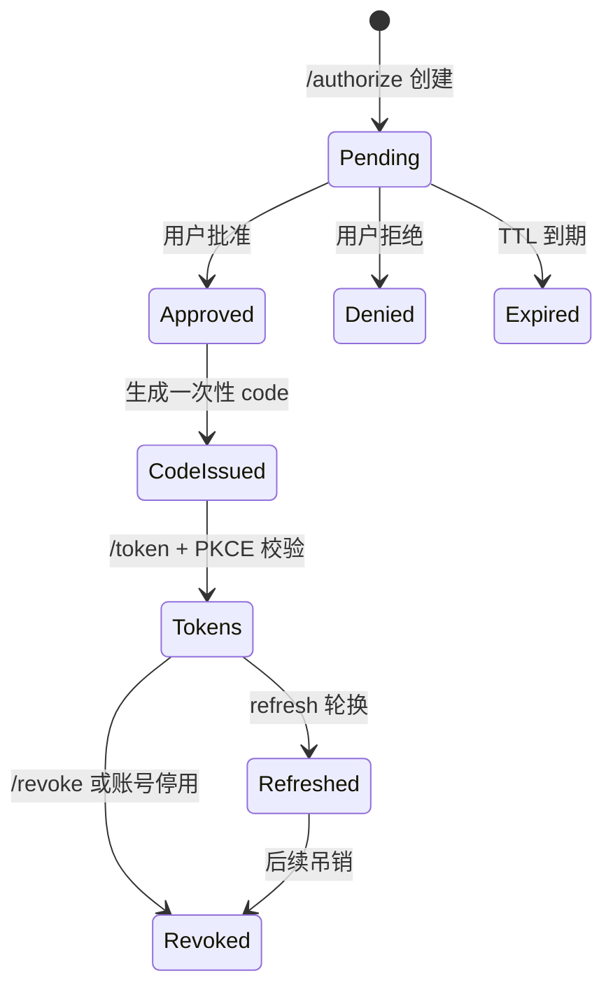
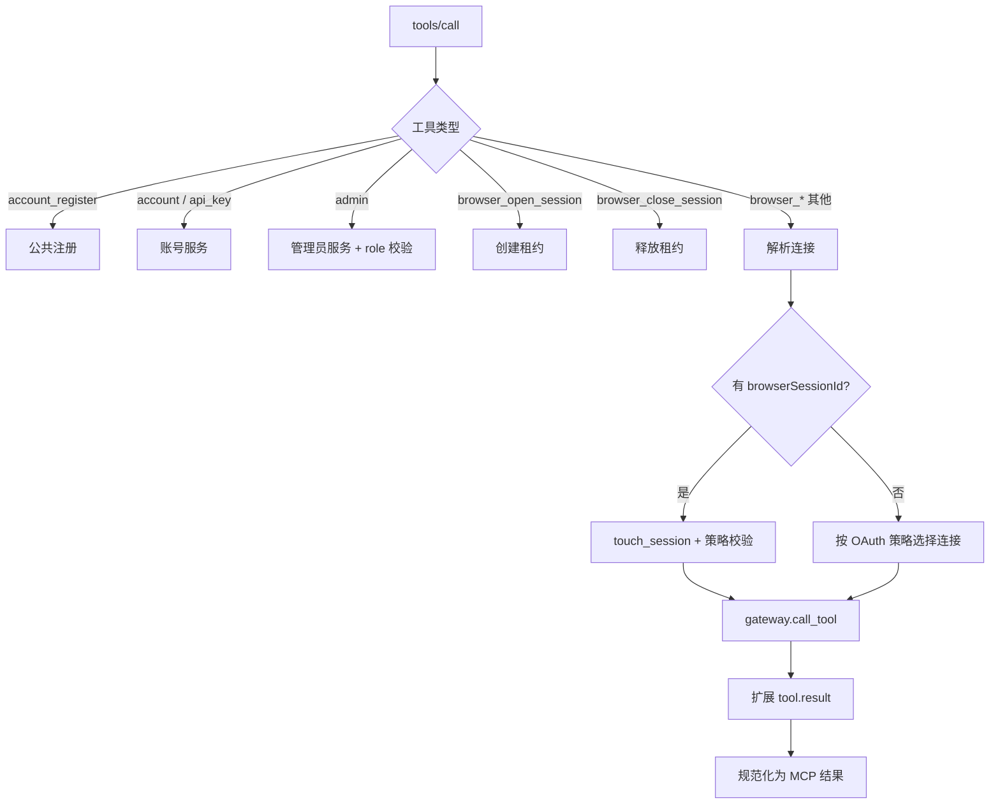

# ABM Server 详细设计

> 本文描述 `browser-mcp-server` 的内部实现。公开 API、消息和字段以 [architecture.md](architecture.md) 为准；本文解释这些契约如何落地、边界在哪里、失败时发生什么。

## 1. 设计目标与约束

服务端是一个 **单进程、异步 FastAPI 应用**，同时承担四种角色：

1. 账号与 API Key 管理服务。
2. MCP Streamable HTTP 服务与 OAuth 2.1 授权服务器。
3. 浏览器扩展 WebSocket 网关。
4. 视频作业协调器与短期下载服务。

关键约束：

- 实时状态（扩展连接、pending 调用、连接租约、视频内容）保存在进程内存。
- 持久状态（账号、会话、Key、OAuth、审计、设置）保存在数据库。
- 当前部署模型默认单实例；多实例需要共享网关和租约状态，未在首期实现。
- API Key 只用于扩展 WebSocket 和换取视频桥令牌；MCP 客户端只使用 OAuth。
- 浏览器工具调用必须最终落到一个明确的 `api_key_id` / 扩展连接。

## 2. 应用装配与启动

`abm_server/main.py::create_app` 按以下顺序创建对象：



启动生命周期 `lifespan`：

1. 配置日志、确保 SQLite 目录存在。
2. 执行 `initialize_identity_state`：
   - 确保 `registration_require_approval` 设置存在。
   - 没有管理员时，按 `ABM_BOOTSTRAP_ADMIN_EMAIL` / `ABM_BOOTSTRAP_ADMIN_PASSWORD` 创建首个管理员。
3. 进入 `mcp_service.run()`：初始化 MCP 会话管理器。
4. 启动 `video_service.start()`：启动视频作业回收任务。
5. 关闭时先停视频服务、再关闭所有扩展连接、最后释放数据库。

HTTP 层：

- 请求 ID 中间件：优先复用 `X-Request-ID`，否则生成 `req_<uuid>`，并在响应头回写。
- `McpPathMiddleware` 把 `/mcp` 与 `/mcp/public` 转交给 MCP ASGI 应用。
- `/healthz` 只检查进程；`/readyz` 检查数据库 `SELECT 1`。
- `/static` 由 FastAPI `StaticFiles` 提供。
- 业务 API 统一挂在 `/api/v1`。

## 3. 模块职责与依赖方向

| 模块 | 实现文件 | 职责 |
|---|---|---|
| 应用入口 | `abm_server/main.py` | 装配、生命周期、健康检查、路由挂载 |
| 配置 | `abm_server/config.py` | `ABM_*` 环境变量、TTL、限额、SQLite 路径 |
| 数据库 | `abm_server/database.py` | 异步引擎、会话、SQLite `WAL` / 外键 / busy timeout |
| 错误模型 | `abm_server/errors.py` | `ApiError`、统一错误响应、请求 ID |
| 并发原语 | `abm_server/concurrency.py` | 固定窗口限流、按 Key 的互斥锁 |
| 账号 | `accounts/service.py` | 注册、登录、会话、密码、身份初始化 |
| API Key | `api_keys/service.py` | 创建、查询、吊销、解析、额度 |
| 管理后台 | `admin/service.py` | 用户筛选、状态/套餐修改、设置、审计查询 |
| 认证 | `auth/dependencies.py` | Cookie 会话、CSRF、管理员、API Key 运行凭证 |
| 社交登录 | `social/providers.py`、`social/service.py` | provider 适配、state/PKCE、自动注册、身份绑定 |
| 创作台检索 | `creation/research/*` | 查询计划、作业状态机、来源抓取与去重 |
| 创作台生成 | `creation/generation.py`、`creation/compose.py`、`creation/llm.py` | 套餐模型解析、提示词组装、OpenAI 兼容调用、版本落库 |
| 创作台发布 | `creation/publish.py` | 发布任务、浏览器打开编辑器、人工回填 |
| 安全原语 | `auth/security.py` | Argon2id、SHA-256 摘要、随机 Key |
| 扩展网关 | `extension_gateway/gateway.py` | 连接、pending 调用、租约、心跳、关闭 |
| 协议 | `extension_gateway/protocol.py` | `abm/1` 信封、错误、关闭码 |
| MCP | `mcp/service.py` | 双端点、工具可见性、scope/角色、浏览器路由 |
| OAuth | `mcp/oauth.py` | DCR、授权码、token、refresh、revoke、连接策略 |
| 工具定义 | `mcp/tools.py`、`tools/browser.py` | 工具 Schema 与工具集合 |
| 视频 | `video/service.py` | 作业、分片、bridge/url/auto、令牌、回收 |
| Web | `web/routes.py` | Landing、登录/控制台、管理台、手册、同意页 |
| 审计 | `audit/service.py` | 账号与运行事件写入 |

依赖方向：

```text
api/routes  →  domain services  →  models / database
mcp/service →  extension_gateway / video / accounts / api_keys / admin
web/routes  →  domain services + templates
```

路由层只做参数校验、依赖注入和响应转换；领域规则在 service 层。旧顶层模块（`gateway.py`、`protocol.py`、`mcp_service.py` 等）只保留兼容 re-export。

## 4. 凭证与认证链

系统有三类凭证，互不替代：

| 凭证 | 使用者 | 存储 | 生命周期 |
|---|---|---|---|
| 账号会话 Cookie | Web 管理台 | `account_sessions.token_hash` | 默认 7 天；退出/改密/停用吊销 |
| OAuth access token | MCP 客户端 | `oauth_access_tokens.token_hash` | 默认 1 小时；可 refresh |
| API Key | 扩展 WebSocket、视频桥 | `api_keys.key_hash` | 长期；用户/管理员吊销 |

### 4.1 账号会话

- Cookie：`abm_session`，`HttpOnly`、`SameSite=Lax`、可配置 `Secure`。
- CSRF Cookie：`abm_csrf`，非 HttpOnly，供前端读取后放入 `X-CSRF-Token`。
- 数据库只存会话令牌的 SHA-256 摘要。
- 每次登录（密码或社交）把客户端 IP 和 User-Agent 写入 `account_sessions`；IP 来自 `request.client.host`，受 uvicorn `forwarded_allow_ips`（`ABM_FORWARDED_ALLOW_IPS`）约束。
- 登录 IP 同时写入会话行和登录审计：`ABM_ACCOUNT_LOGIN` 的 metadata 记录 `ipAddress`、`userAgent`、`method`、`sessionId`。
- 用户在「账号与安全 → 登录会话」和管理员在「用户详情 → 登录记录」都能看到最近会话的 IP 与设备。
- 过期或已吊销且超过 `ABM_SESSION_RETENTION_DAYS`（默认 90 天）的会话由后台任务每 12 小时清理一次；账号删除仍立即级联清理。
- `get_current_auth` 校验：令牌存在、未吊销、未过期、账号 `active`。
- `last_seen_at` 最多每 5 分钟刷新一次。
- 写接口使用 `require_csrf`：
  - Cookie 与请求头中的 CSRF 值必须一致。
  - 请求头值的摘要必须等于会话的 `csrf_hash`。
  - 若请求带 `Origin`，必须匹配 `request.base_url` 或配置的 `ABM_PUBLIC_BASE_URL`。
- 管理员接口使用 `require_admin` / `require_admin_csrf`，在会话校验后再次检查 `role == admin`。

### 4.2 OAuth 运行凭证

MCP `/mcp` 只接受 `Authorization: Bearer <oauth_access_token>`。MCP 中间件解析 token 后构造 `RuntimeAuth`：

```text
user + scopes + auth_kind="oauth" + connection_mode + connection_ids
```

OAuth 的 `connection_mode` / `connection_ids` 会随授权码、access token 和 refresh token 一起保存，确保刷新后策略不丢失。

### 4.3 API Key 运行凭证

`get_runtime_auth` 用于 HTTP 运行接口（视频 API、运行状态）：

- 接受 `Authorization: Bearer abm_...` 或 `X-ABM-API-Key`。
- 解析 Key 的公开前缀，比较完整 Key 的 SHA-256 摘要。
- 拒绝已吊销 Key、停用账号。
- 返回 `RuntimeAuth(api_key=...)`，scope 固定为 `browser`、`account:read`、`account:write`（运行接口自身再做权限判断）。

API Key 不用于 `/mcp`。扩展 WebSocket 在 `session.hello` 中携带 Key，由网关解析。

### 4.4 社交登录

- `GET /api/v1/auth/social/{provider}/start` 生成 `state` 和 PKCE verifier；数据库只保存 `state` 的 SHA-256 摘要和短期 verifier。
- 同步设置 `abm_social_state_<provider>` HttpOnly Cookie；回调必须同时匹配 state 摘要和 Cookie 摘要，防止登录 CSRF。
- 回调只接受未使用、未过期、provider 匹配的 state；使用后立即标记 `used_at`，重复回调返回 `state_invalid`。
- provider 适配层统一输出 `SocialProfile(provider, subject, email, email_verified, display_name, avatar_url)`；微信/QQ 的 `email` 为空。
- 新身份只有在 `email_verified=true` 时才允许直接创建账号；账号状态仍由注册审批设置决定。
- 微信/QQ 首次登录没有邮箱时，创建 `social_pending_registrations` 并跳转 `/social/complete` 补充邮箱；补充的邮箱不会自动绑定已有账号。
- 补充邮箱注册的账号 `email_verified_at` 为空，并发送验证邮件；active 账号可立即使用社交身份登录。
- 已有身份按 `(provider, subject)` 命中；已有同邮箱账号只有在 `email_verified_at` 非空时才自动绑定，避免未验证账号被接管。
- 自动注册账号使用随机密码哈希，后续可通过密码重置设置密码。
- 绑定流程对邮箱型 provider 要求邮箱一致；微信/QQ 绑定到当前已登录账号，不要求 provider 返回邮箱。
- 社交登录成功后复用普通账号会话 Cookie；MCP OAuth 仍需单独授权。

### 4.5 凭证失效传播

| 事件 | 账号会话 | OAuth token | API Key | 扩展连接 |
|---|---|---|---|---|
| 用户退出 | 当前会话吊销 | 不变 | 不变 | 不变 |
| 修改密码（Web） | 其他会话吊销 | 不变 | 不变 | 不变 |
| 修改密码（MCP `account_change_password`） | 其他会话吊销 | 其他 token 吊销，当前 access token 保留 | 不变 | 不变 |
| 吊销单把 Key | 不变 | 不变 | 该 Key 吊销 | 关闭该 Key 连接 |
| 账号停用 | 后续请求拒绝 | 全部 token 吊销 | 后续解析拒绝 | 关闭该用户全部连接 |
| 管理员恢复账号 | 可重新登录 | 需重新授权 | 重新可用 | 可重新连接 |
| 服务重启 | 保持 | 保持 | 保持 | 全部断开，扩展自动重连 |

## 5. 数据模型与事务边界

### 5.1 表与约束

| 表 | 关键约束 / 索引 |
|---|---|
| `users` | `email` 唯一；`(status, created_at)` 索引 |
| `account_sessions` | `token_hash` 唯一；`(user_id, revoked_at)`、`expires_at` 索引 |
| `api_keys` | `public_prefix`、`key_hash` 唯一；`(user_id, revoked_at)` 索引 |
| `settings` | `key` 主键；值为 JSON |
| `account_audit_events` | `(subject_user_id, created_at)`、`(api_key_id, created_at)`、`event_type` 索引 |
| `oauth_clients` | `client_id` 主键；`created_at` 索引 |
| `oauth_pending_authorizations` | `expires_at` 索引 |
| `oauth_authorization_codes` | `code_hash` 唯一；`expires_at` 索引 |
| `oauth_access_tokens` | `token_hash` 唯一；`(user_id, revoked_at)`、`expires_at` 索引 |
| `oauth_refresh_tokens` | `token_hash` 唯一；轮换时吊销旧行 |
| `external_identities` | `(provider, subject)` 唯一；`user_id`、`(provider, email)` 索引 |
| `social_login_states` | `state_hash` 唯一；`expires_at` 索引；`used_at` 一次性 |
| `social_pending_registrations` | `token_hash` 唯一；`expires_at` 索引；绑定浏览器 Cookie |

所有 ID 为 UUID 字符串，时间统一为带时区 UTC。

### 5.2 事务规则

- 每个请求通过 `get_session` 获得一个 `AsyncSession`；路由/服务在完成一组领域操作后显式 `commit`。
- API Key 创建在 `KeyedLockPool` 的用户级互斥锁内完成“计数 + 创建 + 提交”，避免并发突破套餐上限。
- OAuth 授权码兑换在同一个事务中：
  1. 读取未使用且未过期的 code。
  2. 标记 `used_at`。
  3. 签发 access/refresh token。
  4. 提交。
- refresh token 轮换：旧 refresh 标记吊销，新 access/refresh 同事务写入。
- 社交登录回调：
  1. 消费 state，标记 `used_at` 并提交。
  2. 用 code + verifier 换取 provider profile。
  3. 在同一事务中创建/绑定 `external_identities` 和用户，写审计。
  4. active 账号创建账号会话；pending 账号只落库并返回待审批。
- 微信/QQ 首次注册：
  1. profile 没有邮箱时创建 `social_pending_registrations`，绑定 `abm_social_pending` Cookie。
  2. 跳转 `/social/complete` 补充邮箱和显示名称。
  3. 邮箱已存在时返回 `ABM_SOCIAL_EMAIL_CONFLICT`，不自动绑定。
  4. 创建 `email_verified_at=null` 的用户和 identity，写审计并发送验证邮件。
  5. active 账号创建会话；pending 账号等待审批。
- 账号停用：
  1. 更新用户状态并写审计。
  2. 吊销该用户 OAuth token。
  3. 提交后关闭该用户的扩展连接。
- 审计事件与对应业务写入在同一事务中，避免“操作成功但无审计”。

### 5.3 SQLite 配置

`database.py` 对 SQLite 连接设置：

```sql
PRAGMA foreign_keys = ON;
PRAGMA busy_timeout = 15000;
PRAGMA journal_mode = WAL;
```

SQLite 使用 `NullPool`，避免异步连接池持有长期连接导致锁竞争。PostgreSQL 使用同样的 SQLAlchemy 模型和 Alembic 迁移。

写事务必须短：SQLite 同一时刻只允许一个写者，任何会话在写入后如果继续等待网络或扩展调用，其他请求就会在 `busy_timeout` 之后收到 `database is locked`，最终表现为 500。

- 认证依赖刷新 `last_seen_at` 后立即提交，失败则回滚并继续，不能把写锁留到请求结束。
- 发布打开任务时先提交 `opening` 状态，再调用扩展打开浏览器。
- 研究 runner 的每次状态和事件写入都使用独立短会话。
- 回归覆盖：`tests/test_db_concurrency.py`。

## 6. OAuth 2.1 实现

### 6.1 端点与元数据

| 端点 | 作用 |
|---|---|
| `/.well-known/oauth-protected-resource/mcp` | MCP 资源元数据 |
| `/.well-known/oauth-authorization-server` | 授权服务器元数据 |
| `POST /register` | 动态客户端注册（DCR） |
| `GET /authorize` | 校验请求，创建 pending authorization |
| `GET /oauth/authorize` | 登录检查 + 同意页 |
| `POST /oauth/authorize` | 批准 / 拒绝并回跳 |
| `POST /token` | 授权码或 refresh token 换 token |
| `POST /revoke` | 吊销 access / refresh token |

### 6.2 授权状态机



规则：

- DCR 只注册 public client，`token_endpoint_auth_method=none`。
- 授权码必须是 PKCE S256；一次性使用；默认 300 秒。
- pending authorization 默认 600 秒；过期后同意页返回无效请求。
- access token 默认 3600 秒；refresh token 默认 30 天。
- access/refresh 都只保存 SHA-256 摘要。
- refresh token 使用后立即吊销，返回新 refresh token（轮换）。
- `load_access_token` 同时检查 token 未吊销、未过期、用户 `active`。
- 账号停用会吊销该用户全部 OAuth token。
- MCP 的 `account_change_password` 会吊销其他账号会话，并吊销除当前 access token 外的其他 OAuth token；Web 的 `PATCH /api/v1/auth/password` 只吊销其他账号会话，不主动吊销 OAuth token。

### 6.3 连接策略

同意页允许三种策略：

| 策略 | 保存内容 | 路由含义 |
|---|---|---|
| `auto` | 空连接列表 | 该用户所有在线连接；多连接时要求显式 `browserSessionId` |
| `pinned` | 恰好一个 `api_key_id` | 固定到该连接，可直接使用 |
| `pool` | 一个或多个 `api_key_id` | 只允许池内连接；多连接时要求显式 `browserSessionId` |

批准时服务端会重新校验：

- `pinned` 必须且只能有一个连接。
- `pool` 的每个 ID 必须属于当前用户且未吊销。
- 非法 ID 返回 `ABM_VALIDATION_ERROR`。
- 策略写入授权码，再写入 access/refresh token。

## 7. MCP 服务实现

### 7.1 双端点

- `/mcp`：OAuth 认证，返回 23 个 browser + 7 个 account/API Key 工具；管理员额外 5 个 admin 工具。
- `/mcp/public`：无认证，只暴露 `account_register`。
- 未认证 `/mcp` 返回 `401` 和 `WWW-Authenticate`，指向受保护资源元数据。
- 使用 MCP SDK v2（`mcp>=2.3,<3`），由 SDK 处理 JSON-RPC、协议版本协商和 Streamable HTTP 传输；同时服务 2026-07-28 与更早的握手式客户端。

### 7.2 工具可见性与角色

```text
scope browser         → browser_*（23）
scope account:read    → account_me / api_key_list / admin 读工具（管理员）
scope account:write   → 账号写 / Key 写 / admin 写工具（管理员）
```

- 普通用户调用管理员工具返回 `ABM_ADMIN_REQUIRED`。
- 工具 Schema 的 `additionalProperties=false`，未知参数会被拒绝。
- 工具业务失败使用 MCP 工具错误结果，并携带 `ABM_*` 错误码。

### 7.3 工具分发



### 7.4 浏览器连接解析优先级

`_call_browser_tool` 的顺序：

1. `browser_open_session` / `browser_close_session` 特殊处理。
2. 如果参数带 `browserSessionId`：
   - `gateway.touch_session(user_id, browserSessionId)` 续租。
   - 失效 → `ABM_BROWSER_SESSION_INVALID`。
   - 连接必须符合 OAuth 的 pinned/pool 范围，否则 `ABM_CONNECTION_FORBIDDEN`。
3. 否则调用 `_gateway_key_id`：
   - OAuth `pinned`：直接使用固定连接。
   - OAuth `auto` / `pool` 且没有 MCP transport session：返回 `ABM_BROWSER_SESSION_REQUIRED`，要求先 `browser_open_session`。
   - 有 MCP transport session：按 session id 获取/续租连接。
   - 旧式或 API Key 运行凭证：回退到该用户最近活跃的在线连接。
4. 没有在线连接 → `ABM_EXTENSION_OFFLINE`。
5. 连接被其他会话占用 → `ABM_CONNECTION_BUSY`。

`browser_open_session` 生成 `bs_<random>`，绑定 `(user_id, browserSessionId) → api_key_id`，TTL 默认 1800 秒。`browser_close_session`、连接断开、TTL 到期都会释放租约。

### 7.5 服务端执行的浏览器工具

23 个 `browser_*` 中有 4 个不转发给扩展：

| 工具 | 执行位置 |
|---|---|
| `browser_open_session` | 服务端：租约分配 |
| `browser_close_session` | 服务端：释放租约 |
| `browser_stage_video` | 服务端：视频作业 + 网关 |
| `browser_send_notice` | 服务端：`notice.push` |

其余 19 个由扩展执行。

## 8. 扩展网关实现

### 8.1 连接注册

- 每个 `api_key_id` 最多一个 `GatewayPeer`。
- 同一 Key 新连接到来时：
  1. 释放旧 Key 的所有租约。
  2. 替换连接表。
  3. 向旧连接发送 `ABM_CONNECTION_REPLACED`（关闭码 1000）并关闭。
- 连接断开时释放该 Key 的全部租约，并让该 Key 的所有 pending 调用失败（`ABM_EXTENSION_OFFLINE`）。

### 8.2 握手与心跳

1. 客户端建立 WebSocket，必须声明子协议 `abm.v1`。
2. 服务端在 `ABM_HELLO_TIMEOUT`（默认 10 秒）内等待 `session.hello`。
3. 校验信封、API Key、扩展 ID、版本。
4. 注册 peer，发送 `session.ready`。
5. 心跳循环每 30 秒发送 `session.ping`；90 秒无活动则关闭。
6. 客户端收到的 `session.ping` 必须回 `session.pong`；任意有效消息刷新 `last_seen`。

### 8.3 pending 调用

`call_tool`：

1. 检查目标连接在线。
2. 生成 `call_<uuid>`，建立 `PendingCall`。
3. 发送 `tool.invoke`。
4. 等待 `tool.result`，超时默认 300 秒。
5. `tool.result` 必须来自同一 `api_key_id` 且匹配请求 `id`。
6. 超时/断线/替换都会让 Future 失败，并映射为 `ABM_TOOL_TIMEOUT` / `ABM_EXTENSION_OFFLINE`。

### 8.4 连接租约

租约数据结构：

```text
(user_id, session_id) → { api_key_id, created_at, last_used_at, expires_at }
api_key_id → (user_id, session_id)   # 反向占用表
```

`acquire_connection_for_session`：

- 清理过期租约。
- 已有租约且连接仍在线：续租并复用。
- 指定 `preferred_api_key_id`：必须在线且未被其他会话占用。
- 未指定：在允许范围内选择未被占用的连接，按用户轮询游标分配。
- 全部被占用 → `ABM_CONNECTION_BUSY`；无在线 → `ABM_EXTENSION_OFFLINE`。

### 8.5 关闭语义

- 业务错误放在 `error` payload 中，WebSocket 只使用标准关闭码。
- `retryable=false` 或终止错误码会停止重连。
- Key 无效/吊销、账号停用会触发扩展端停止自动重连并要求用户处理。
- 服务关闭发送 `ABM_SERVER_SHUTTING_DOWN`（1001），扩展按退避重连。

## 9. 视频服务实现

### 9.1 作业模型

```text
VideoJob {
  id, api_key_id, file_name, file_type, file_size,
  total_chunks, path, delivery, token,
  status: pending | delivering | delivered | failed,
  download_url, completion
}
```

- 作业按 `api_key_id` 隔离。
- 视频源流式写入临时文件，内存只保留当前分片；服务重启即丢失。
- 临时文件在交付、失败或 TTL 到期后删除，不进入对象存储。
- 作业 TTL 默认 30 分钟，后台每 60 秒清理。
- 单 Key 和全局活跃作业都有上限，超限返回 `ABM_VIDEO_BUSY`。
- 交付成功后立即释放视频内容和临时文件。
- 视频桥页面不接收 API Key：扩展用 API Key 向 `/api/v1/video/bridge-token` 换取短期令牌，页面只持有该令牌。

### 9.2 模式选择

| 请求 | 源 | 扩展在线 | 实际模式 |
|---|---|---|---|
| `bridge` | 任意 | 任意 | `bridge` |
| `url` | URL | 任意 | `url`，扩展直连原始 URL |
| `url` | base64 | 任意 | `url`，服务端临时托管后一次性下载 |
| `auto` | URL | 任意 | `url`，优先直连 |
| `auto` | base64 | 是 | `url` |
| `auto` | base64 | 否 | `bridge` |

`auto` 直连失败时不静默回退到服务器中转；权限不足返回 `ABM_VIDEO_PERMISSION_REQUIRED`，由用户授权后重试。

### 9.3 URL 模式

URL 源：

1. 服务端不下载视频，只创建作业并保存原始 URL。
2. 通过网关调用扩展 `browser_download_video_from_url`。
3. 扩展检查 host 权限并直接下载源地址。
4. 扩展返回 `fileSize` / `fileType`；服务端更新作业。
5. 扩展随后用 `browser_set_video_to_page` 注入页面。

base64 源：

1. 服务端把 base64 分块解码并流式写入临时文件。
2. 生成一次性 `download_url`（含随机 token）。
3. 扩展从该地址下载到暂存区，服务端在交付后删除临时文件。

### 9.4 Bridge 模式

1. 服务端把 base64 或 URL 源流式写入临时文件，不整包驻留内存。
2. 视频桥页面轮询 `/api/v1/video/jobs?pending=1`。
3. 桥页面逐片读取 `/chunks/{index}`，通过 `abm.video.*` 外部消息推给扩展。
4. 扩展组装后写入暂存区，并回报 `start` / `complete`。
5. 服务端结算作业并删除临时文件。

### 9.5 下载令牌

- 每个作业独立随机 token。
- 使用 `secrets.compare_digest` 常量时间比较。
- 只有 `pending` 作业可下载。
- 下载完成后释放临时文件；后续请求返回 `ABM_VIDEO_EXPIRED`。

### 9.6 视频桥令牌

- 扩展用 API Key 调用 `POST /api/v1/video/bridge-token`，换取短期令牌。
- 服务端只保存令牌的 SHA-256 摘要；默认 TTL 3600 秒。
- 令牌只被视频路由的 `get_video_auth` 接受，不能访问账号、Key 或其他 API。
- `abm.bridge.config` 把令牌交给桥页面，不返回 API Key；桥页面不把 Key 写入 localStorage。
- 手动输入 API Key 时，页面先换取令牌并立即清空输入框。

## 10. Web 管理台实现

- Jinja2 模板 + 原生 ES Module，无前端构建步骤。
- 全部账号页面支持中英文，语言保存在 `abm.lang`；未保存时跟随客户端语言（zh / en，其他回退 en）。
- `base.html` 在首屏绘制前解析语言；英文时临时隐藏中文模板，翻译完成或 2 秒兜底后解除。
- 首次访问的语言检测结果不写入手动选择，只有点击语言按钮才持久化。
- MCP 工具描述、工具结果、HTTP 错误消息和 OAuth `error_description` 使用英文规范文案，错误码 `ABM_*` 保持稳定。
- 页面资源带 `?v={{ asset_version }}`，避免静态缓存。
- 登录/注册使用深色 auth card；控制台和管理后台使用统一 panel/list 组件。
- API Key 明文只在创建后的一次性面板展示。
- 页面脚本通过 `/api/v1` 调用服务端，并使用 `X-CSRF-Token`。
- 控制台通过 `abm.connection.configure` 一键写入扩展配置；扩展校验来源与目标服务器同源。
- 控制台生成 Claude Code、Codex CLI、Cursor/Windsurf 和通用 HTTP MCP 配置。
- 控制台轮询 `/api/v1/extension/status` 展示扩展在线状态，并通过 `/api/v1/usage/summary` 展示按 Key 用量。
- 控制台提供 8 个中英文工作流模板，prompt 可复制给 Agent。
- 控制台通过 `/api/v1/auth/account/export` 下载 JSON 数据导出。
- 认证失败时前端跳转 `/login`，支持安全 `next` 回跳。

## 11. 并发、失败与降级

| 场景 | 行为 |
|---|---|
| 并发创建 Key | 用户级锁串行化，确保额度不被突破 |
| 并发 OAuth code 兑换 | 先标记 `used_at`，后签发；重复兑换失败 |
| 社交 state 重复/过期 | 回调跳转 `/login?social_error=state_invalid`，不创建会话 |
| provider 返回未验证邮箱 | 拒绝自动注册/绑定，提示使用密码登录 |
| 同邮箱已有未验证账号 | 拒绝自动绑定，要求密码登录后在控制台绑定 |
| 微信/QQ 首次登录无邮箱 | 跳转 `/social/complete` 补充邮箱，不自动绑定已有账号 |
| 补充注册 token 重复/过期 | `ABM_SOCIAL_PENDING_INVALID`，重新发起社交登录 |
| 社交账号绑定冲突 | `(provider, subject)` 已属于其他用户时返回 `link_taken` |
| 扩展连接被替换 | 旧连接 pending 调用立即失败，租约释放 |
| 扩展断线 | 所有 pending 失败，租约释放，新调用返回离线 |
| 视频作业超时 | 结算为 `failed`，删除临时文件 |
| 数据库不可用 | `/readyz` 返回 503；业务请求返回 `ABM_INTERNAL_ERROR` |
| 进程重启 | 持久数据保留；扩展重连；内存视频/租约丢失 |
| 多实例部署 | 不保证跨实例连接和租约；需要额外的共享状态设计 |

## 12. 可观测性

- 结构化日志字段：请求 ID、用户 ID、API Key 前缀/ID、扩展 ID、工具名、耗时、视频作业 ID、错误码。
- 禁止记录密码、会话令牌、CSRF、API Key 秘密、视频字节。
- `GET /healthz`：进程存活。
- `GET /readyz`：数据库可用。
- 运行状态 `GET /api/v1/session/status`：账号、Key 前缀、扩展连接信息、pending 数量。

## 13. 测试映射

| 测试文件 | 覆盖范围 |
|---|---|
| `tests/test_accounts.py` | 注册、登录、会话、改密、账号状态 |
| `tests/test_social.py` | 五类 provider、自动注册、审批、账号绑定、补充邮箱注册、state 重放、解绑 |
| `tests/test_oauth.py` | DCR、PKCE、同意/拒绝、token、refresh、revoke、连接策略 |
| `tests/test_extension_gateway.py` | 握手、心跳、替换、pending、租约、关闭码 |
| `tests/test_mcp_integration.py` | MCP 协议协商、工具可见性、浏览器路由、账号/管理员工具 |
| `tests/test_system.py` | 健康检查、错误结构、运行状态、配置 |
| `tests/test_web.py` | 页面渲染、双语、静态资源 |
| `tests/test_packaging.py` | 打包入口、依赖和发布约束 |

## 14. 扩展点与修改清单

新增一个 HTTP API：

1. 在 `schemas.py` 定义请求/响应模型。
2. 在 `api/routes/` 增加路由，使用正确的认证依赖。
3. 在领域 service 中实现规则和事务。
4. 补测试：成功、校验、未授权、跨用户、状态冲突。
5. 更新 `architecture.md` 第 13 节。

新增一个 MCP 工具：

1. 在 `mcp/tools.py` 或 `tools/browser.py` 定义 Schema。
2. 在 `mcp/service.py` 实现分发；浏览器工具要明确是否转发扩展。
3. 若转发扩展，在扩展 `tools/registry.js` 注册并实现。
4. 更新两仓库的契约测试和工具清单。
5. 更新 `architecture.md` 第 18 节与扩展文档。

新增或修改 `abm/1` 消息：

1. 更新 `extension_gateway/protocol.py` 与扩展 `core/protocol.js`。
2. 更新错误码、关闭码和重试语义。
3. 更新 `data-flow.md` 与 `scenarios.md`。
4. 两仓库分别运行契约测试。

## 15. 用量计量

- `abm_server/usage/service.py` 按 UTC 日期写入 `usage_daily`。
- `McpService._call_browser_tool` 在解析出连接 `api_key_id` 后记录工具调用；视频作业额外记录 `video_jobs` 和 `relayedBytes`。
- `UsageService` 用进程内锁串行化 upsert，避免同一 Key 同一天并发插入冲突。
- 计量异常只写日志，不影响工具结果。
- `GET /api/v1/usage/summary?days=30` 返回 `totals`、`byKey` 和 `daily`，控制台用量面板直接消费。
- 当前只统计不扣费；配额、账单和支付在后续阶段补充。
- `ABM_QUOTA_ENFORCEMENT=hard` 时，`McpService` 在浏览器工具调用前检查当月用量；工具调用或视频配额用尽返回 `ABM_QUOTA_EXCEEDED`，`soft` 只展示不阻断。

## 16. 账号恢复与安全操作

- 邮箱验证和密码重置使用 `account_tokens`，只保存 SHA-256 摘要，token 一次性使用。
- `EmailService` 支持 `log` 和 `smtp` 两种模式；本地开发默认 `log`，生产设置 `ABM_EMAIL_MODE=smtp`。
- 密码重置确认后更新密码、吊销其他账号会话和 OAuth token，并写审计事件。
- 控制台展示活跃会话，可撤销单个会话或退出其他会话；当前会话通过退出登录结束。
- 删除账号需要当前密码和 CSRF 校验；最后一个管理员不能删除；删除前关闭该账号的扩展连接并吊销 OAuth token。
- 账号删除后，API Key、会话、account token 和 usage 记录随外键级联删除；审计事件保留但解除用户关联。

## 17. 通知与告警

- `usage_alerts` 按 `(api_key_id, month, threshold)` 去重，月度 80% / 100% 只通知一次。
- 告警通道：扩展 `notice.push`、邮件（`ABM_EMAIL_MODE`）、`ABM_ALERT_WEBHOOK_URL` Webhook。
- `account_notices` 保存控制台通知，控制台每 30 秒刷新，支持单条已读和全部已读。
- API Key 吊销会写入账号通知；扩展断开时写入“扩展离线”通知，同一用户 60 分钟内去重。
- API Key 吊销、配额阈值和扩展离线共用控制台通知中心。

## 18. 社交登录与账号绑定

### 18.1 Provider 适配

| Provider | 授权 | 用户信息 | 邮箱验证 |
|---|---|---|---|
| WeChat | OAuth 2.0 | `sns/userinfo` | 不返回邮箱；补充邮箱后注册 |
| QQ | OAuth 2.0 | `user/get_user_info` | 不返回邮箱；补充邮箱后注册 |
| Google | OIDC + PKCE | `openidconnect.googleapis.com/v1/userinfo` | `email_verified` |
| GitHub | OAuth 2.0 | `/user` + `/user/emails` | primary 或任一 verified 邮箱 |
| Microsoft | OIDC + PKCE | Microsoft Graph OIDC userinfo | `email` claim |

- client secret 只从 `ABM_SOCIAL_*` 环境变量读取，不下发到页面。
- 未配置 client ID/secret 的 provider 自动隐藏。
- 所有 provider 使用相同的 `redirect_uri` 规则，生产必须配置 `ABM_PUBLIC_BASE_URL`。

### 18.2 注册与绑定决策

```text
callback
  -> identity(provider, subject) exists?
     -> yes: 校验账号状态，登录
     -> no : provider email present?
        -> no : 创建 pending registration，跳转 /social/complete 补充邮箱
           -> 邮箱已存在: email_conflict，要求密码登录后绑定
           -> 新邮箱: 创建用户（email_verified_at=null）+ identity，按审批 active/pending
        -> yes: provider email verified?
           -> no : email_unverified
           -> yes: 同邮箱账号存在?
              -> no : 创建用户 + identity（按审批设置决定 active/pending）
              -> yes: 账号邮箱已验证?
                 -> no : email_conflict，要求密码登录后绑定
                 -> yes: 创建 identity，登录
```

绑定入口在控制台“账号 → 登录方式”。邮箱型 provider 要求邮箱一致；微信/QQ 绑定到当前已登录账号，不要求 provider 返回邮箱。解绑需要 CSRF，解绑后其他登录方式仍然有效。

### 18.3 错误码

| 错误码 | 场景 |
|---|---|
| `ABM_SOCIAL_DISABLED` | provider 未配置或关闭 |
| `ABM_SOCIAL_STATE_INVALID` | state 缺失、过期、重复使用 |
| `ABM_SOCIAL_EMAIL_UNVERIFIED` | provider 未确认邮箱 |
| `ABM_SOCIAL_EMAIL_CONFLICT` | 同邮箱已有未验证账号 |
| `ABM_SOCIAL_LINK_MISMATCH` | 绑定邮箱与账号不一致 |
| `ABM_SOCIAL_LINK_TAKEN` | 该 provider 身份已绑定其他账号 |
| `ABM_SOCIAL_PENDING_INVALID` | 微信/QQ 补充注册 token 无效或过期 |
| `ABM_SOCIAL_EMAIL_REQUIRED` | 该 provider 不返回邮箱，需要补充注册 |
| `ABM_SOCIAL_PROVIDER_ERROR` | provider 网络或协议错误 |

回调错误通过 `/login?social_error=<short-code>` 返回页面，页面根据 `abm.lang` 显示中英文提示。
